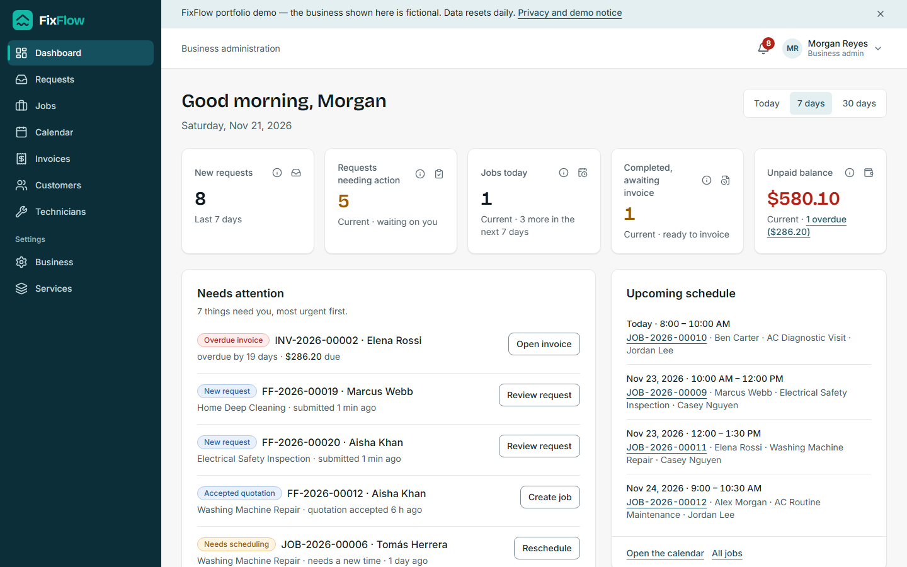
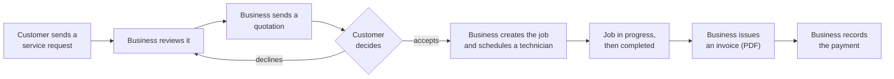
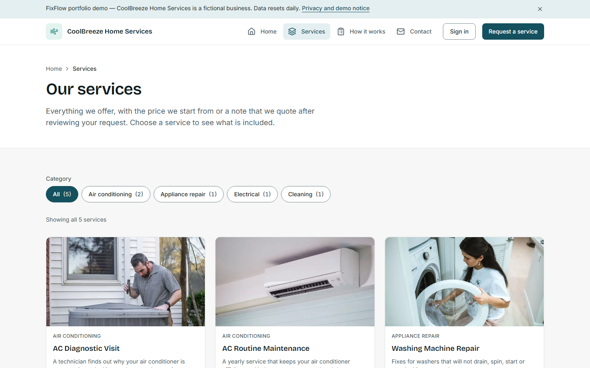
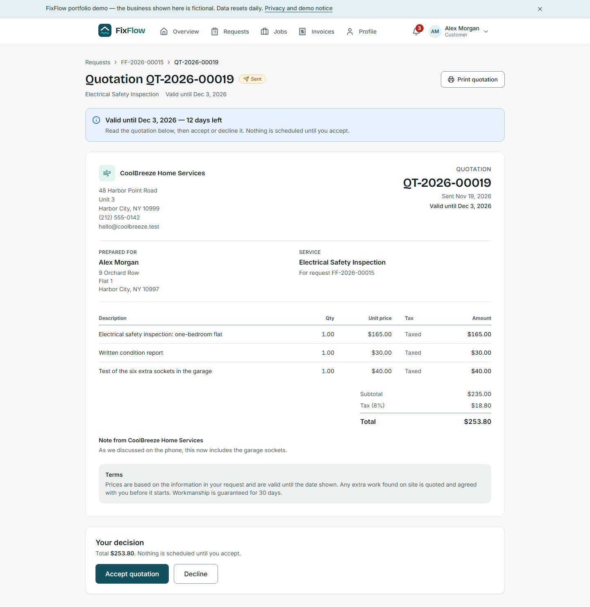
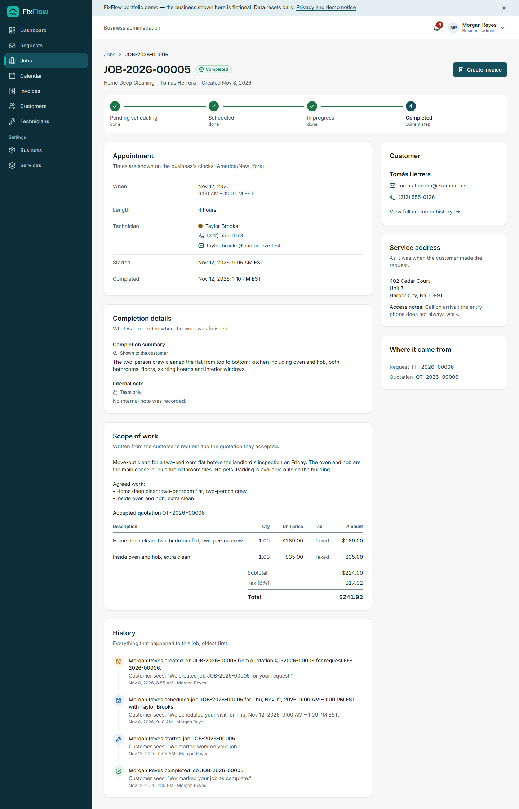
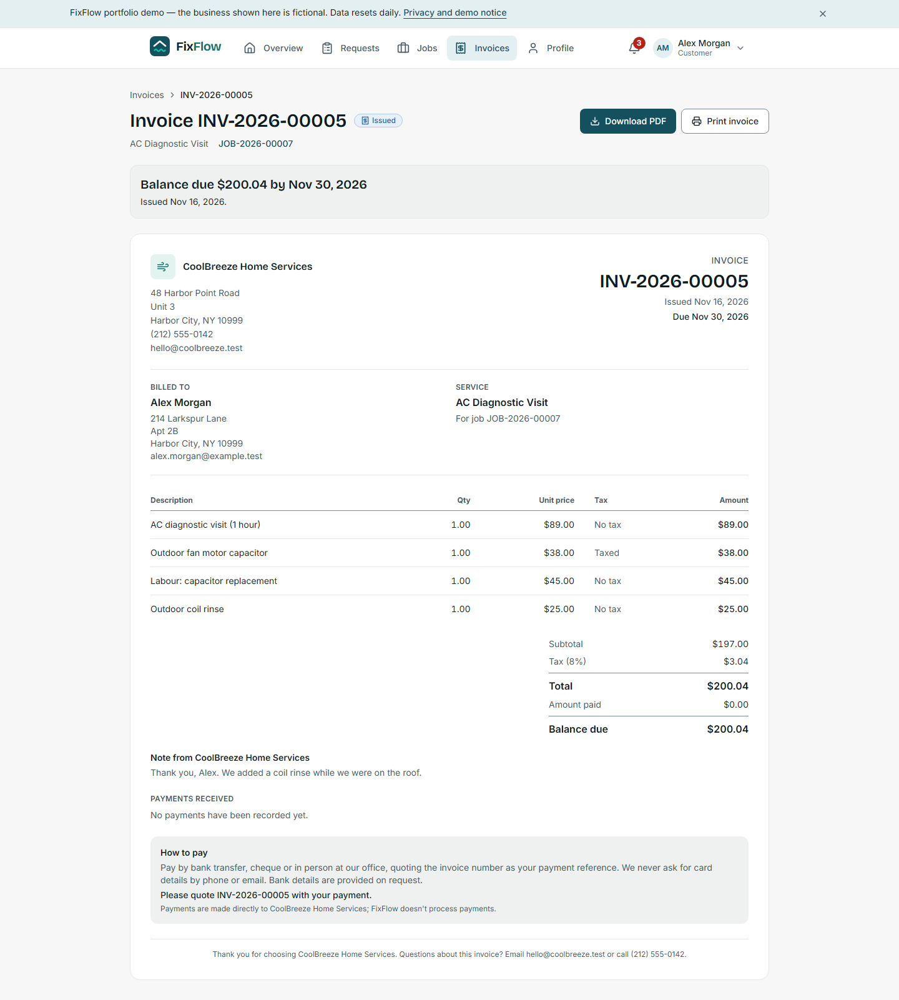
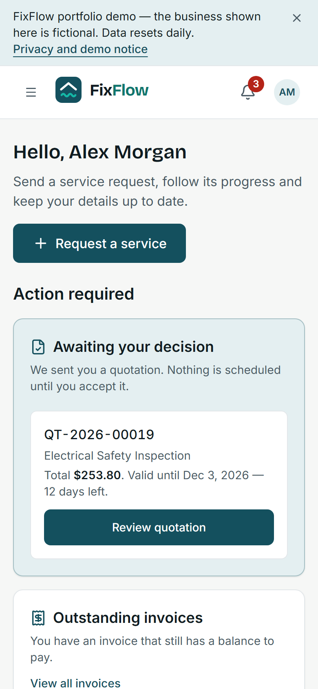
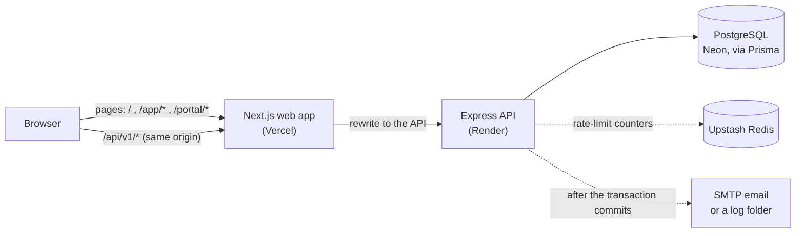

# FixFlow

**FixFlow is a web application that helps a small home-service business run its day-to-day work, from a customer's first request to the recorded payment.** A customer asks for a service and approves a quotation; the business reviews the request, schedules and completes the job, issues an invoice and records the payment. It has a public website, a business admin dashboard and a customer portal in one application.

It was built as a **self-initiated portfolio project** for one fictional business, _CoolBreeze Home Services_. It is not a commissioned system, has no clients, and every person, address, price and amount in the demo is fictional. [More on its status](#project-status-and-contribution-scope).



## The problem it solves

A small repair or maintenance company typically runs on separate tools: requests arrive by phone and message, quotations are typed into a document, the schedule is in a calendar, and invoices are made somewhere else. Nothing connects them, so the business cannot see what needs doing next, and a customer cannot see where their job stands. FixFlow puts that journey in one place:



## Screenshots

Real captures of the running application on its demo data, in the order of the walk-through ([how they are made](#retaking-the-screenshots)).

|                                                                                                                                                                       |                                                                                                                                                                               |
| --------------------------------------------------------------------------------------------------------------------------------------------------------------------- | ----------------------------------------------------------------------------------------------------------------------------------------------------------------------------- |
| **1. Business dashboard.** Five live figures and a "needs attention" queue, read from the database.  | **2. Public services.** The business's own website, filled from the settings and the service catalogue.       |
| **3. Quotation and approval.** What the customer reads, with the total and their decision.  | **4. Work order.** A completed job: progress, appointment, what was done, the accepted scope and its history.  |
| **5. Printable invoice.** The invoice document, with a PDF download and a print layout.                          | **6. Customer portal on a phone.** "Action required" comes first.                                |

One more, of the scheduling calendar: [`docs/screenshots/07-job-calendar-week.png`](docs/screenshots/07-job-calendar-week.png). The public photographs are credited stock images (see `apps/web/public/images/CREDITS.md`); everything else on screen is the application.

## Live demo

- **Production demo: not published yet.** A public demo with published demo credentials and daily-reset data is the last release step and has not been done; this README will name its address when it exists.
- **Hosted preview:** https://fixflow-preview.vercel.app is a deployment of the app on the same providers (Vercel, Render, Neon), used to check hosting. It has the base seed only (the business, five services, three demo accounts), not the full demo data, and its demo passwords are not published here. The free Render plan sleeps when idle, so the first visit can take up to a minute.
- **Run it yourself in about ten minutes:** [Quick start](#quick-start) below loads the full demo data on your machine.

## What it does

**Public website** (`/`, `/services`, `/services/<slug>`, `/privacy`): the business's home page, its active services with prices or "request a quote", and a request form that needs a free account.

**Customer portal** (`/portal`): register with email and password or Google; send a service request (a saved or typed address, a preferred day and time window); follow its status and history; read a quotation, **accept or decline** it; see scheduled and completed jobs with the technician's first name; see invoices, the balance and the payments received, **download the PDF**; keep a profile and service addresses. Notifications in the app and by email.

**Business admin dashboard** (`/app`): a dashboard of live figures and a needs-attention queue; the **request queue** with search, filters and notes (internal or shared with the customer); the **quotation builder** (line items, discount, tax, live totals, send, replace, void); **jobs** created from accepted quotations; **scheduling** with technician resources and an overlap check; a **calendar** (week, day, agenda); the job lifecycle (start, complete with a customer summary, send back for a new time, cancel); **invoices** from completed jobs (issue, void, print, PDF); **manual payment records** with corrections by void; a customer directory with internal notes; CSV exports of requests, jobs and invoices; settings for the business and the service catalogue.

**Engineering qualities that run through all of it:** every total, status, reference and timestamp is decided on the server; role _and_ ownership are enforced on every endpoint; a business change commits together with its history and notification, and emails are sent only afterwards; duplicate submissions and races are handled with locks, conditional updates and database constraints; money is decimal arithmetic, never floats; times are stored in UTC and shown in the business's time zone. [Architecture](docs/ARCHITECTURE.md) explains each.

### Explicitly out of scope

FixFlow does **not** include, and does not pretend to include: multiple businesses or tenants (it serves one), subscriptions or billing for using FixFlow, a payment gateway or any card data (payments are manual records of money received elsewhere), technician logins, route optimisation or live location, native mobile apps, accounting or tax filing, payroll or procurement, SMS or WhatsApp messages, reviews or marketing campaigns, a workflow builder, AI features, and file uploads. Ideas for the future are in [docs/ARCHITECTURE.md](docs/ARCHITECTURE.md#14-known-limitations-and-future-work) and are not implemented.

## Architecture



The browser only ever talks to the web origin, which proxies `/api/v1/*` to the API, so the session cookie stays first-party. Server Components read data through the API with the cookie forwarded; the web app never touches the database.

| Choice                                                       | Why                                                                                                                                         |
| ------------------------------------------------------------ | ------------------------------------------------------------------------------------------------------------------------------------------- |
| **Next.js (App Router) + TypeScript (strict)**               | One application for three experiences; server-rendered reads, typed end to end                                                              |
| **Tailwind CSS + shadcn-style components on Radix + Lucide** | Design tokens declared once; accessible, keyboard-operable primitives                                                                       |
| **Express 5 API + Zod**                                      | The server is the authority; strict request schemas; a clear layer for business rules and transactions                                      |
| **PostgreSQL (Neon) + Prisma**                               | Relational integrity: partial unique indexes and CHECK constraints enforce the rules that matter (one live invoice per job, no overpayment) |
| **Opaque server-side sessions, Argon2id, Google Sign-In**    | An HTTP-only cookie holding a random token; only its hash is stored; passwords never stored in the clear                                    |
| **Upstash Redis**                                            | Distributed rate limiting (an in-process limiter locally)                                                                                   |
| **Nodemailer behind an `EmailSender` interface**             | SMTP in production, a log transport everywhere else; a failed email never reverses a business action                                        |
| **`decimal.js`, `date-fns` + `@date-fns/tz`**                | Exact money; explicit business time zone                                                                                                    |
| **`pdfmake`**                                                | Invoice PDFs built in the API process, no headless browser                                                                                  |
| **Vitest, Supertest, Playwright, axe**                       | Unit, API integration (real PostgreSQL), end-to-end on three browser engines, accessibility                                                 |
| **Vercel (web), Render (API), Neon (database)**              | The hosting the project was designed for ([DEPLOYMENT.md](docs/DEPLOYMENT.md))                                                              |

It is an npm-workspaces monorepo: `apps/web`, `apps/server`, `packages/shared` (enums, error codes, DTO types and the money calculation), `e2e`.

## Quick start

**Prerequisites:** Node.js 24 LTS (`.nvmrc`; check `node --version`), npm 10 or newer, and Docker with Compose (for the local PostgreSQL).

```bash
git clone <this repository> fixflow && cd fixflow
npm install
npm run build:shared && npm run db:generate          # builds @fixflow/shared and generates the Prisma client (both git-ignored)

cp apps/server/.env.example apps/server/.env        # works as is for local development
cp apps/web/.env.example apps/web/.env.local
# in apps/web/.env.local set NEXT_PUBLIC_DEMO_MODE=true to see the "Demo accounts" panel on the sign-in page

npm run db:test:up                                   # PostgreSQL 18 on localhost:5433 (waits until healthy)
docker compose exec postgres createdb -U fixflow_test fixflow_dev     # the development database, once
npm run db:deploy                                    # apply the migrations
npm run db:seed:demo                                 # base data + the demo dataset (about 15 seconds)

npm run dev                                          # web on :3000, API on :4000
```

Open http://localhost:3000, then **Sign in** ([demo accounts](#demo-accounts)). `npm run dev`, `lint`, `typecheck`, `test` and `build` do the `build:shared` and `db:generate` step themselves; the `db:*` commands do not, so run it once after installing. Without the database steps the site starts but has no business data, and the API's `/api/v1/health/ready` answers `503`. `npm run db:test:down` stops the database later; its data survives in a Docker volume.

### Environment variables

Every variable, with its default and a comment, is in [`apps/server/.env.example`](apps/server/.env.example) and [`apps/web/.env.example`](apps/web/.env.example). Both apps start with no file at all for the UI alone; the API validates its environment at start-up and exits naming each bad variable (never its value). The ones you are most likely to touch:

| Variable                                                          | App       | What it does                                                                                                                |
| ----------------------------------------------------------------- | --------- | --------------------------------------------------------------------------------------------------------------------------- |
| `DATABASE_URL`, `DIRECT_DATABASE_URL`                             | API       | The running API's connection and the migrations' connection (the same locally; on Neon the pooled and the direct URL)       |
| `TEST_DATABASE_URL`                                               | API       | The integration tests' database. They **empty** it; the test utilities refuse to touch any other                            |
| `SESSION_SECRET`                                                  | API       | HMAC key for session and reset-link hashes (32+ characters). Required in production                                         |
| `ADMIN_EMAILS`                                                    | API       | The only emails that can be the business admin. The demo admin `admin@demo.fixflow.test` must be listed                     |
| `DEMO_ADMIN_PASSWORD`, `DEMO_CUSTOMER_PASSWORD`                   | API       | The demo accounts' passwords, used by the seed                                                                              |
| `DEMO_MODE`                                                       | API       | `true` on a public demo: locks the shared demo accounts' passwords and the business identity, adds write and sign-up limits |
| `GOOGLE_CLIENT_ID` / `NEXT_PUBLIC_GOOGLE_CLIENT_ID`               | API / web | Google Sign-In (blank switches it off; email and password still work)                                                       |
| `EMAIL_TRANSPORT`, `EMAIL_FROM`, `SMTP_*`                         | API       | `log` (default) writes each email to `.data/outbox/`; `smtp` delivers. Production needs all of them                         |
| `UPSTASH_REDIS_REST_URL`, `UPSTASH_REDIS_REST_TOKEN`              | API       | Distributed rate limiting; required in production, blank locally                                                            |
| `API_INTERNAL_URL`                                                | web       | Where the Next.js server reaches the API (default `http://localhost:4000`)                                                  |
| `NEXT_PUBLIC_DEMO_MODE` and the two `NEXT_PUBLIC_DEMO_*_PASSWORD` | web       | Show the "Demo accounts" panel with the published demo passwords                                                            |

**Email locally.** With the default `log` transport nothing is delivered: each email is written as a `.txt` and `.html` file to `.data/outbox/` and recorded as "logged", never "sent". Addresses on reserved domains (`.test`, `example.com`) always use it, so the demo can never email a stranger.

## Database, seed and the demo reset

| Command                                 | What it does                                                                                                                                                         |
| --------------------------------------- | -------------------------------------------------------------------------------------------------------------------------------------------------------------------- |
| `npm run db:test:up` / `db:test:down`   | Start / stop the local PostgreSQL (`docker-compose.yml`, port 5433)                                                                                                  |
| `npm run db:deploy`                     | Apply the existing migrations (`prisma migrate deploy`): the only way schema changes reach a shared database                                                         |
| `npm run db:migrate -- --name <change>` | Create and apply a migration to the **development** database                                                                                                         |
| `npm run db:seed`                       | Idempotent base data: the business settings, five services, three technicians, three demo accounts                                                                   |
| `npm run db:seed:demo`                  | The base seed, then the demo dataset into an empty business, then the invariant checker                                                                              |
| `npm run db:verify-demo`                | Check the demo data against 18 invariants (read-only)                                                                                                                |
| `npm run db:reset-demo`                 | **Empties** the demo database and reloads it. Refuses unless `DEMO_MODE=true` and `CONFIRM_DEMO_RESET` is the database's name; never runs against the test databases |
| `npm run db:studio`                     | Prisma Studio                                                                                                                                                        |

The demo dataset has 8 customers, 4 technicians, 20 requests in every status, 19 quotations, 13 jobs and 6 invoices (issued, partly paid, paid, overdue, void and a draft), with history and notifications. It is built by calling the application's own services, and every date is relative to the moment it runs. A public demo should reset daily: a scheduled GitHub Actions workflow does it once enabled ([DEPLOYMENT.md](docs/DEPLOYMENT.md)).

## Tests and CI

```bash
npm run lint && npm run typecheck && npm run build
npm run test                 # unit tests, every workspace; no database needed
npm run test:integration     # API integration tests against TEST_DATABASE_URL (needs db:test:up); about 15-25 minutes
npx playwright install chromium firefox webkit       # once
npm run test:e2e             # Playwright: the main journey on Chromium, Firefox and WebKit, negative and resilience
                             # journeys, a keyboard-only journey, an accessibility sweep of every screen at 360/768/1024/1440 px
```

**Last full run** (2026-11-21, in a fresh clone following this README): format, lint, typecheck and build pass; unit tests 331 (shared) + 2,342 (API) + 2,398 (web, plus 1 skipped); integration tests 2,250 in 58 files (about 12 minutes). The end-to-end suite (about 900 tests across three browser engines) was last run in full during the quality-hardening work, in four runs none of which was entirely green because of a few known flaky older tests; it was not re-run for the documentation, apart from the screenshot script. `npm run test:e2e` starts its own API, web apps and databases (`fixflow_e2e`, `fixflow_e2e_showcase`) on ports 3000, 3001, 4000 and 4100, so stop `npm run dev` first. What each suite covers, and why, is in [Architecture, testing strategy](docs/ARCHITECTURE.md#13-testing-strategy). The integration tests include an **authorization matrix** that probes every registered route (84) as a visitor, a customer and an admin, a **customer DTO leak test** that searches whole responses for internal data, and concurrency tests for the races that matter (double acceptance, two payments for one balance, two bookings of one technician).

**CI** (`.github/workflows`): format, lint, typecheck, unit tests, integration tests against a PostgreSQL service and a build on every push to `main` and every pull request; an end-to-end job on Chromium; a nightly three-engine run; and the daily demo reset (off until enabled).

### Retaking the screenshots

`npm run screenshots` retakes the pictures in `docs/screenshots/` from the running application: it starts its own servers on a database of demo data (`fixflow_e2e_screenshots`), signs in through the real form and finds each page by clicking. To photograph a deployed demo instead: `BASE_URL=https://<site> E2E_DEMO_ADMIN_PASSWORD=… E2E_DEMO_CUSTOMER_PASSWORD=… npm run screenshots`.

## Demo accounts

Ordinary accounts with local passwords; there is no special demo sign-in. With `NEXT_PUBLIC_DEMO_MODE=true` the sign-in page has a **Demo accounts** panel that fills in the real form.

| Account                      | Email                      | Password (local development values) | What it can do                                                                                                                            |
| ---------------------------- | -------------------------- | ----------------------------------- | ----------------------------------------------------------------------------------------------------------------------------------------- |
| Business admin: Morgan Reyes | `admin@demo.fixflow.test`  | `DemoAdmin-2026!`                   | Runs the business: requests, quotations, jobs, scheduling, invoices, payments, dashboard, exports                                         |
| Customer: Alex Morgan        | `alex.morgan@example.test` | `DemoCustomer-2026!`                | Sends requests, answers quotations, follows jobs and pays invoices. In the demo data Alex has a quotation to answer and an invoice to pay |
| Customer: Priya Shah         | `priya.shah@example.test`  | `DemoCustomer-2026!`                | A second customer, to see that customers only ever see their own records                                                                  |

These passwords are **published on purpose** and belong to a throwaway local database; a hosted demo uses different values. **Safe demo use:** all data is fictional, and anyone using the shared admin account can read what other visitors enter, so please enter only fictional details. In demo mode the shared accounts cannot change their passwords, the shared admin cannot change the business name, logo or contact details, the shared accounts are limited to 60 changes in 10 minutes, each IP address to 3 sign-ups an hour, and email to the demo accounts is only logged.

A walk-through for a video or a live demonstration, with exact clicks, is in [docs/DEMO_SCRIPT.md](docs/DEMO_SCRIPT.md).

## Known limitations

- **Payments are manual records.** There is no gateway, refund or credit balance. FixFlow is not accounting or tax software: tax is one configurable rate per document.
- **Scheduling is deliberately simple:** no working hours, travel time or recurring availability ("free" means nothing is booked); the calendar has week, day and agenda views but no drag-and-drop or month view.
- **Email has no retry queue**, and a log-only email is recorded as logged, never sent. Quotation expiry and invoice overdue are applied when the data is next read.
- **Not built:** email-address change, account deletion, file uploads, a full notifications page.
- **Release status:** the production demo has not been released; the hosted preview has the base data only. The Google sign-in was checked by hand on the preview. **Real SMTP delivery has not been checked yet** (the preview sends no email); the email code is covered by the automated tests with the log transport.
- **Dependency advisories:** `npm audit --omit=dev` currently reports advisories in Next.js 16.4.x and in a Prisma CLI dependency (`effect`). They have not been upgraded yet, and should be before any public launch.
- **Test coverage notes:** the suites ran on Windows with Chromium, Firefox and WebKit (mobile widths are emulated; no real phone or Safari). A few older end-to-end tests are known to be flaky under load.

## Project status and contribution scope

FixFlow is a **portfolio project**: a work sample that shows how a full-stack web application can be designed, built, tested and deployed. It is **not** a commissioned system and makes no claim about clients, customers, users or business outcomes; "CoolBreeze Home Services" and everything in the demo are fictional.

**Who did what.** A first-person description of the contribution (design, frontend, API, database, testing and deployment) and of how AI-assisted development was used is written by the project owner in [the case study](docs/PORTFOLIO_CASE_STUDY.md#4-my-contribution). This README does not make that claim for them.

This repository is a showcase maintained by one person. It is not set up for outside feature contributions.

## Documentation

| Document                                                     | What it is                                                                                                                                                                                                                         |
| ------------------------------------------------------------ | ---------------------------------------------------------------------------------------------------------------------------------------------------------------------------------------------------------------------------------- |
| [docs/ARCHITECTURE.md](docs/ARCHITECTURE.md)                 | How the system fits together: topology, layering, the domain rules (transition maps, money, scheduling locks, time-based changes), the data model, the security model, email and PDF pipelines, the frontend, the testing strategy |
| [docs/API.md](docs/API.md)                                   | The REST API: conventions, the error-code catalogue, the route index (84 routes) and every endpoint                                                                                                                                |
| [docs/DEPLOYMENT.md](docs/DEPLOYMENT.md)                     | Hosting on Vercel, Render and Neon: variables, first-time setup, migrations, release, rollback, the demo reset, troubleshooting                                                                                                    |
| [docs/DESIGN_SYSTEM.md](docs/DESIGN_SYSTEM.md)               | The visual system, components, status vocabulary and screen blueprints                                                                                                                                                             |
| [docs/DEMO_SCRIPT.md](docs/DEMO_SCRIPT.md)                   | A 2 to 3 minute walk-through for a video, with clicks and talking points                                                                                                                                                           |
| [docs/PORTFOLIO_CASE_STUDY.md](docs/PORTFOLIO_CASE_STUDY.md) | The portfolio case study (the owner completes the contribution section)                                                                                                                                                            |
| [render.yaml](render.yaml)                                   | The Render Blueprint for the API                                                                                                                                                                                                   |
