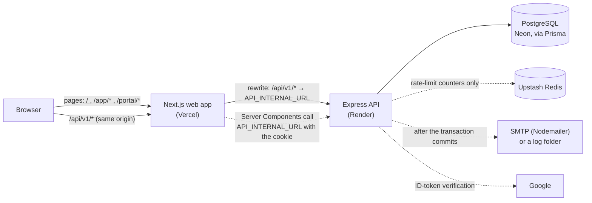
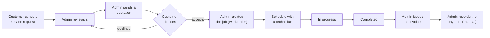
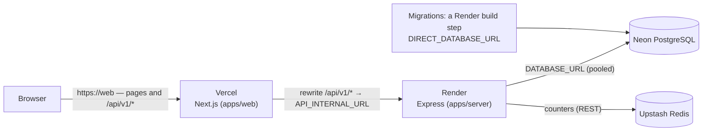
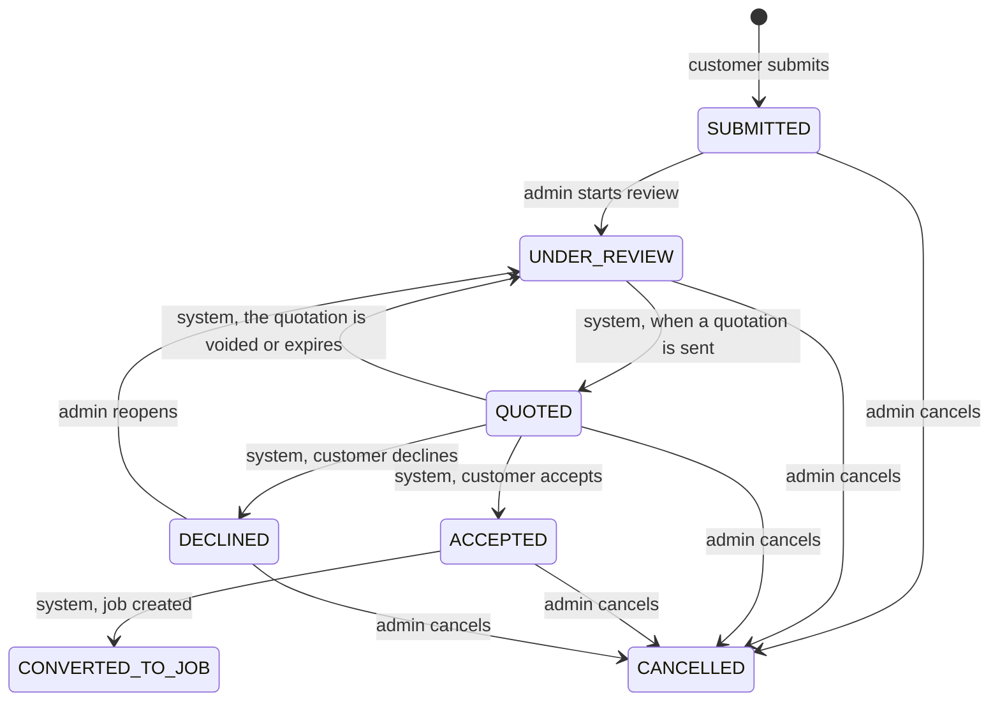
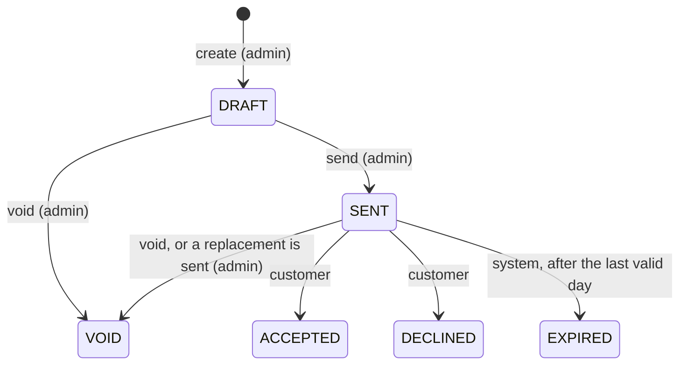
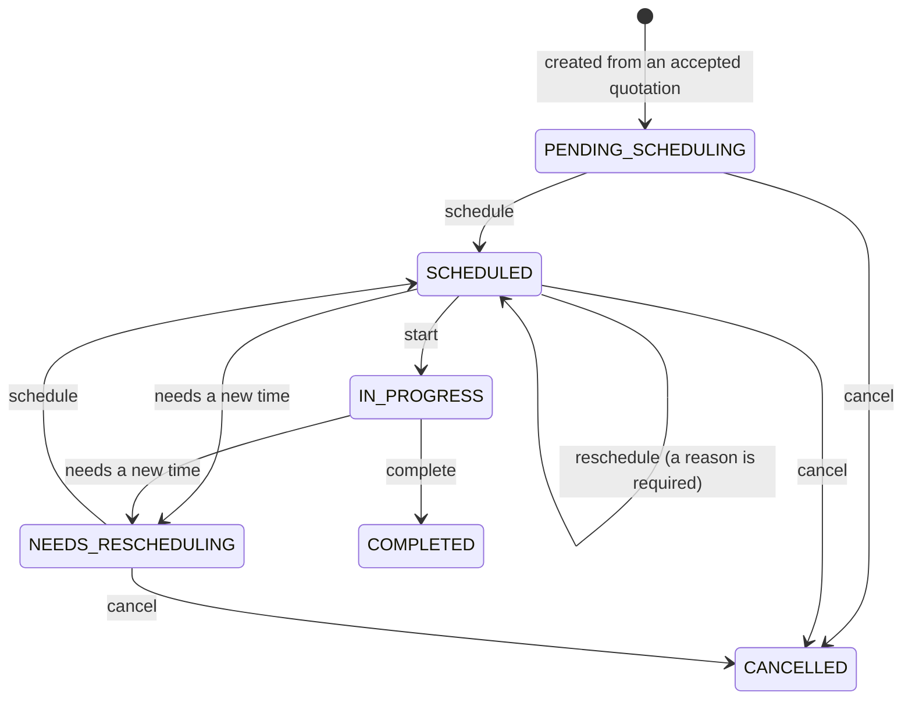
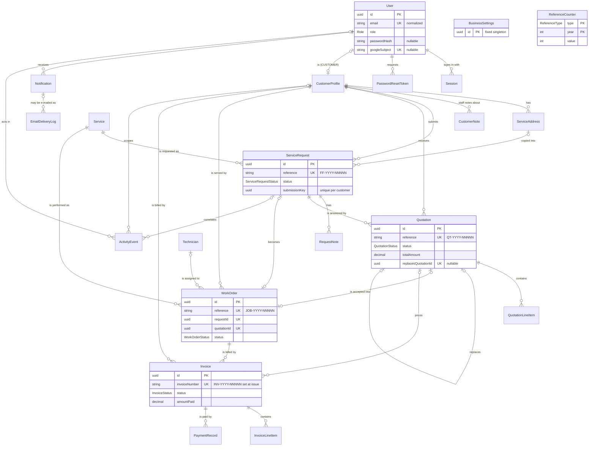
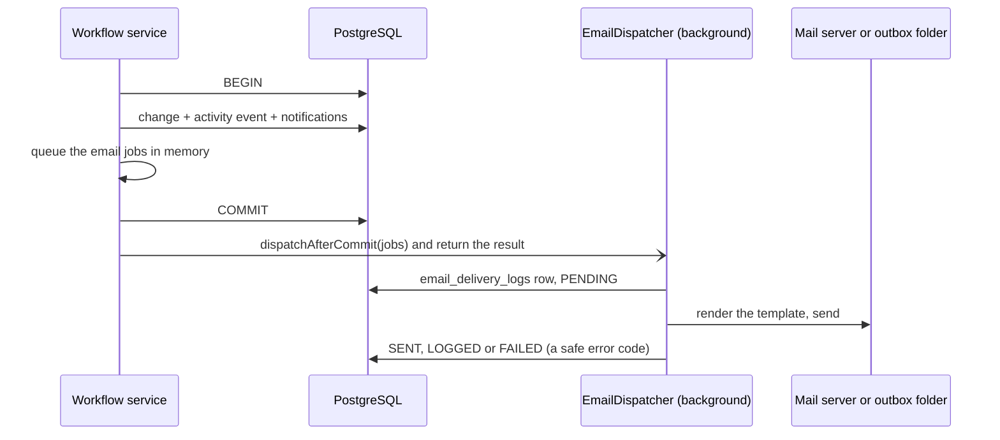

# FixFlow — Architecture

How FixFlow is put together, and why. The HTTP contract is in [API.md](API.md); deployment and operations are in [DEPLOYMENT.md](DEPLOYMENT.md); the visual system is in [DESIGN_SYSTEM.md](DESIGN_SYSTEM.md).

FixFlow is a self-initiated portfolio project: one web application for **one** small home-service business (the fictional _CoolBreeze Home Services_). It has no multi-tenancy, no payment processing and no technician logins. Every statement below describes what exists in the repository; things that do not exist are in [section 14](#14-known-limitations-and-future-work) and are labelled as future.

**Contents:** [1 System context](#1-system-context) · [2 Deployment topology](#2-deployment-topology) · [3 Repository and layering](#3-repository-and-layering) · [4 The request pipeline](#4-the-request-pipeline) · [5 Backend modules](#5-backend-modules) · [6 Domain rules](#6-domain-rules) · [7 Data model](#7-data-model) · [8 Security model](#8-security-model) · [9 Activity, notifications and email](#9-activity-notifications-and-email) · [10 The invoice PDF](#10-the-invoice-pdf) · [11 Frontend structure](#11-frontend-structure) · [12 Demo data and the reset](#12-demo-data-and-the-reset) · [13 Testing strategy](#13-testing-strategy) · [14 Known limitations and future work](#14-known-limitations-and-future-work)

## 1. System context

One Next.js application serves three experiences, in front of one Express API and one PostgreSQL database.

| Experience | Routes | Who |
| --- | --- | --- |
| Public website | `/`, `/services`, `/services/<slug>`, `/privacy`; `/request-service` (the form needs an account: a visitor is sent to sign-in and back) | anyone |
| Business admin dashboard | `/app/*` | the business admin (`BUSINESS_ADMIN`) |
| Customer portal | `/portal/*` | signed-in customers (`CUSTOMER`) |

There are exactly two authenticated roles. Technicians are **records the admin schedules**, not accounts.



The primary journey, which every part of the system exists to support:



Three rules shape the whole design:

1. **The server is authoritative.** Authentication, roles, ownership, validation, money totals, references, status transitions and timestamps are decided on the API. The web app has no database access and no business rules beyond display hints; it never trusts a total, a status or an identity that comes from the browser.
2. **A business change is one transaction.** The change, its history entry and its in-app notification commit together; emails are queued inside the transaction and sent only after it has committed.
3. **The two audiences are separate shapes.** A customer never receives the object an admin receives. Customer and admin serializers are different functions, and tests pin the keys.

## 2. Deployment topology



**The same-origin proxy and the cookie.** The browser only ever talks to the web origin. Next.js rewrites `/api/v1/*` to `${API_INTERNAL_URL}/api/v1/*` (`apps/web/next.config.ts`). This matters because the web app and the API live on different registrable domains: a cookie set by the API's own domain would be a third-party cookie that Safari and Firefox block. Through the rewrite, the session cookie is first-party to the web origin. Server Components call the API directly through `API_INTERNAL_URL` and forward the incoming cookie.

**The cookie** (details in [API.md](API.md#9-authentication-sessions-and-csrf)): an opaque random token, `HttpOnly`, `SameSite=Lax`, `Path=/`, no `Domain`, `Secure` and the `__Host-` prefix in production, seven days, renewed while in use. Only its HMAC-SHA-256 hash is stored.

**CSRF and CORS.** Every unsafe request must carry an `Origin` equal to the web origin (or `Sec-Fetch-Site: same-origin`), otherwise it is `403 CSRF_ORIGIN_MISMATCH`, answered before the body is read. The rewrite preserves the browser's `Origin`. CORS allows exactly one origin and exists as defence in depth.

**Client addresses.** The API reads the caller's address through Express's `trust proxy`, set by `TRUST_PROXY` (the number of proxy hops). It is a deployment setting, not a guess: with the wrong count every visitor shares one per-IP rate-limit counter, so it was measured on the hosted preview and recorded in [DEPLOYMENT.md](DEPLOYMENT.md#84-client-address-and-trust_proxy).

**Environments.** Local development and the tests use a Docker PostgreSQL; hosted environments use separate Neon branches that are never shared. The Prisma client connects through the pooled URL at runtime; migrations use the direct URL. Rate limiting uses Upstash in production and an in-process limiter locally. Email uses SMTP in production and a `log` transport everywhere else. A full configuration table, the release procedure and the operations runbook are in [DEPLOYMENT.md](DEPLOYMENT.md).

**Fail fast.** The API validates its whole environment at start-up and exits with status 1, naming each bad variable (never its value). Production additionally requires `WEB_ORIGIN`, `DATABASE_URL`, `SESSION_SECRET`, the Upstash credentials, `RATE_LIMIT_MULTIPLIER=1` and, for the `smtp` transport, every SMTP variable.

## 3. Repository and layering

```text
apps/web/          Next.js app: routes, features, components (section 11)
apps/server/       Express 5 API: src/{config,lib,middleware,modules,db,test}, prisma/
packages/shared/   @fixflow/shared: enums, status labels, error codes, limits, DTO types,
                   and the pure money calculation (no I/O, no framework code)
e2e/               Playwright: tests/, journeys/, showcase/, screenshots/, support/, fixtures/
docs/              documentation
```

`@fixflow/shared` compiles to `dist/` and both apps import that output, so the root scripts build it first.

**API source layout**

```text
apps/server/src/
  server.ts        process entry: load .env (dev only), validate config, build deps, listen, shut down
  app.ts           createApp(deps): middleware and routers in a fixed order
  deps.ts          AppDeps + createProductionDeps(config)
  config/          env.ts (Zod-validated, frozen Config), dotenv.ts
  lib/             logger, errors, pagination, clock, shutdown, rate-limit/, db, password (Argon2id),
                   references (FF-/QT-/JOB-/INV-), transaction (runInTransaction: change + queued emails)
  middleware/      request-id, rate-limit, validate, not-found, error-handler
  modules/<m>/     one folder per domain module (section 5)
  db/              base seed, showcase data, invariant checker, guarded reset
  test/            test harness: buildTestApp, fixtures, route inventory, database guards
apps/server/prisma/   schema.prisma, migrations/, seed entry points
```

**Layers.** Each depends only downward.

| Layer | File | Responsibility |
| --- | --- | --- |
| Routes | `<m>.routes.ts` | HTTP only: mount `validate(...)` and the role guard, call a service, wrap the result in `{ data }` |
| Schemas | `<m>.schemas.ts` | Zod. Request bodies are strict objects: an unknown key is rejected |
| Service | `<m>.service.ts` | Business logic and transactions; throws `AppError` |
| Domain | `<m>.domain.ts`, `<m>.transitions.ts` | Pure rules (transition tables, calculations, sentences) and the **only** code that writes a status |
| DTO | `<m>.dto.ts` | Serializers. Customer and admin serializers are separate functions |

**Dependency injection** is a typed object passed explicitly, with no framework:

```ts
interface AppDeps {
  config: Config;                 // validated, frozen environment
  clock: Clock;                   // now(); a FakeClock in tests
  logger: Logger;                 // pino
  prisma: PrismaClient;           // the one database client
  rateLimiter: RateLimiter;       // Upstash in production, in-memory locally and in tests
  rateLimits: RateLimitTable;     // the named limits in force
  emailSender: EmailSender;       // SMTP or the log transport
  emailDispatcher: EmailDispatcher; // sends queued emails after a commit; never throws
  googleVerifier: GoogleIdTokenVerifier; // google-auth-library in production, a fake in tests
  background: BackgroundTasks;    // work after the response (emails); tests await idle()
}
```

Nothing reads `process.env` after start-up and nothing uses a global singleton. Anything time-dependent (expiry, overdue, scheduling, rate-limit windows) takes the injected `Clock`, so tests are deterministic.

## 4. The request pipeline

`createApp` mounts middleware in this order; the order is deliberate.

| # | Middleware | Why it sits here |
| - | --- | --- |
| 1 | `requestId` | First, so every log line and every response (errors and 429s too) carries the ID |
| 2 | request logger (pino-http) | Needs the ID; logs one line when the response finishes |
| 3 | `helmet` | Security headers on every response, including errors |
| 4 | `Cache-Control: no-store` | Every response is dynamic and often private; ETags are off |
| 5 | `cors` | Answers preflight before anything can count or reject it |
| 6 | CSRF `Origin` check | Before the body is read, so a forged request costs only the `403` |
| 7 | `express.json` (100 kb, strict) | Parses the body once; oversize and malformed bodies become `413`/`400` |
| 8 | global rate limit | 300 requests a minute per IP, after CORS so preflights do not consume it |
| 9 | routers | `/api/v1/health`, `/auth`, then each module; guards are per route |
| 10 | not-found handler | Anything unmatched becomes `404 NOT_FOUND` |
| 11 | error handler | The single place errors become responses |

The session is not loaded by a global middleware: each protected route runs a guard (`requireAuth`, `requireCustomer`, `requireAdmin`), so public routes never touch the database for it.

**Errors.** Expected failures are `AppError`s thrown anywhere below the handler. The central handler maps an `AppError` to its status, code and message; a `ZodError` to `422 VALIDATION_ERROR` with `fieldErrors` by dotted path; a body-parser error to `400` or `413`; anything else to a generic `500` whose cause is logged with its stack and never returned. Every error body is `{ error: { code, message, fieldErrors?, details?, requestId } }`. The full catalogue is in [API.md](API.md#4-status-codes-and-error-codes).

**Logging.** pino with pino-http, one JSON line per request in production. Redaction removes cookies, `Authorization`, `Set-Cookie` and any field named `password`, `passwordConfirmation`, `newPassword`, `currentPassword`, `credential`, `token` or `secret`. Request bodies, query strings and response headers are never logged; email addresses are masked (`a***@example.test`).

**Rate limiting.** One map of named limits (`apps/server/src/lib/rate-limit/limits.ts`; the table is in [API.md](API.md#7-rate-limiting)). `consume` counts a request; `peek` counts nothing, which lets sign-in count only _failed_ attempts without locking out someone who signs in successfully. If the limiter's store fails, the request is allowed and the failure is logged, so a Redis outage does not take the API down.

## 5. Backend modules

| Module (`apps/server/src/modules/`) | Responsibility |
| --- | --- |
| `health` | Liveness (never touches the database) and readiness (`SELECT 1`, 3 s timeout) |
| `auth` | Registration, local sign-in, Google sign-in, sessions, password reset and change, the guards, demo-account locks |
| `email` | Templates, transports, routing, the delivery log and the after-commit dispatcher |
| `activity` | `recordActivity` (the only writer of history) and `getTimeline` (two audiences) |
| `notifications` | `notify`/`notifyAdmins` and the in-app notification endpoints |
| `settings` | The single business-settings record (name, contact, currency, time zone, tax, invoice defaults) |
| `services` | The service catalogue and the public service endpoints |
| `customers` | A customer's own profile and addresses, and the portal overview; the admin customer directory |
| `requests` | Customer submission and tracking; the admin queue, review, notes and cancellation |
| `quotations` | Builder, sending, replacement, voiding, expiry, and the customer's decision |
| `technicians` | Technician resource records (no logins) |
| `work-orders` | Conversion from an accepted quotation, scheduling, the lifecycle, the calendar, the customer's job pages |
| `invoices` | Drafting, issuing, voiding, manual payments, the customer's invoice pages and the PDF |
| `dashboard` | The admin summary read from the database |
| `exports` | Streamed CSV exports of requests, jobs and invoices |

## 6. Domain rules

### 6.1 Status transition maps

Every status is a Prisma enum from `@fixflow/shared`. Each module has its transitions as **data** in `<m>.domain.ts`; a pair that is not in the table is not allowed, whoever asks. Status is written only through `<m>.transitions.ts`. Every transition endpoint takes `expectedStatus` and answers `409 STALE_STATE` if the record has changed, or `409 INVALID_STATE_TRANSITION` if the table forbids the pair; the record is left unchanged in both cases.

**Service request**



`CANCELLED` and `CONVERTED_TO_JOB` have no way out. Cancelling needs an internal reason, keeps who and when, and voids the request's open quotations in the same transaction.

**Quotation**



A sent quotation is never edited: **Replace** starts a new draft from it, and sending that voids the old one.

**Work order (job)**



A pending job cannot be completed, a job in progress cannot be cancelled, and `COMPLETED` and `CANCELLED` are terminal.

**Invoice.** Status is _derived_ from the total, the active payments, the due date and issue/void, with the precedence `VOID > DRAFT > PAID > OVERDUE > PARTIALLY_PAID > ISSUED` (`deriveInvoiceStatus`, pure, used by every serializer). The persisted column follows the same table:

- an admin may `ISSUE` a draft and `VOID` a draft, issued or overdue invoice (never one with active payments);
- the system moves an issued or partly paid invoice to `OVERDUE` once its due date has passed on the business's calendar;
- recording a payment moves `ISSUED`, `PARTIALLY_PAID` or `OVERDUE` to `PARTIALLY_PAID`, `PAID` or (past due) `OVERDUE`; voiding a payment moves it back (`PAID`/`PARTIALLY_PAID` to `PARTIALLY_PAID`, `ISSUED` or `OVERDUE`).

Each of the four tables is unit-tested over **every** pair of statuses for each trigger.

### 6.2 Money

`calculateDocumentTotals` in `@fixflow/shared` (`money.ts`, `decimal.js` with a private half-up clone) is the only place the arithmetic lives. The server runs it to decide what is stored; the quotation and invoice editors run the same function for the live preview, so they can differ only if the inputs do.

1. `lineSubtotal = round(quantity × unitPrice)`; `subtotal = Σ lineSubtotal`; `taxableSubtotal` is the sum over taxable lines.
2. One fixed `discountAmount` per document, `0 ≤ discount ≤ subtotal`.
3. The discount is spread in proportion, so only the taxable share lowers the tax base: `taxableBase = round(taxableSubtotal × (subtotal − discount) ÷ subtotal)`.
4. `taxAmount = round(taxableBase × taxRate ÷ 100)`; `totalAmount = subtotal − discount + taxAmount`. Every `round` is two decimal places, half up.

Amounts are decimal **strings** from the database to the screen, with an explicit `currencyCode`; there is no JavaScript number in the path. Columns are `numeric(12,2)` (amounts), `numeric(10,2)` (quantities) and `numeric(5,2)` (tax rates), and no floating-point column exists anywhere (a schema test enforces it). A request body that names a total is rejected with `422`: the server always recomputes from the stored lines. Worked examples (252.00 with taxable 45.50 gives tax 3.64 and total 255.64; a discount of 25.20 gives 230.08) are unit tests.

`amountPaid` on an invoice is only ever written as the sum of its active payments (`applyPaymentToInvoice`), never from a client value or the previous amount, so it cannot drift.

### 6.3 Concurrency and scheduling

The same toolkit is used everywhere a duplicate or a race would be wrong:

- **Row locks** (`SELECT … FOR UPDATE`) serialise the operations that can change what the record may do next: a request's lock for quotations and conversion, the work order's and then the technician's lock for scheduling, the invoice's lock for issuing, paying and voiding. Lock order is fixed (work order, then technician), so there is no deadlock.
- **Conditional updates** (`UPDATE … WHERE id AND status = <the status read>`), so of two racing writers exactly one finds the status it expected.
- **Unique constraints** as the last line of defence (one draft, one sent and one accepted quotation per request; one job per quotation and per request; one non-void invoice per job). A unique violation that slips through is mapped to the same answer as the loser of a race (`200` with the existing record, or `409`), never a `500`.
- **Idempotent submission.** A request carries a `submissionKey` that is unique per customer, so a double click or a retry after a lost response returns the first request and creates nothing new.

**Scheduling** (`scheduleWorkOrder`) runs in one transaction: lock the work order, then the technician, and only then query for overlapping jobs, so a second scheduling for the same technician waits, sees the first one's committed job and is refused with `409 SCHEDULING_CONFLICT`. The overlap rule is one half-open interval test, `scheduledStart < end AND scheduledEnd > start`, over jobs that are `SCHEDULED` or `IN_PROGRESS` (excluding the job itself): **back-to-back visits are allowed**; a job that needs a new time stops holding the technician's time. Only active technicians can be given new work. The domain function and the SQL query are tested at the same edges (touching, inside, around, identical, one millisecond).

**Conversion is one job however many ask.** `convertToWorkOrder` is idempotent: a quotation that already has a job returns it; otherwise one transaction locks the request, re-reads, checks that the quotation and the request are both `ACCEPTED`, allocates the `JOB-` reference, inserts the job with a snapshot of the customer, service and address, and moves the request to `CONVERTED_TO_JOB`.

### 6.4 Time

- Timestamps are stored in UTC (`timestamptz`); date-only fields are `date`. The API speaks ISO 8601 UTC instants and `YYYY-MM-DD` dates.
- **Business logic and display use the business's time zone from the settings, never the browser's.** `@fixflow/shared` converts a business wall-clock date and time to an instant (`wallClockToInstant`) and back with `Intl` only, naming the zone explicitly; a time the clocks skip is rejected and a repeated time is the first. This is tested under several machine time zones and across both clock changes.
- References are numbered per type and per year of the business calendar (`FF-2026-00012`): `nextReference` does one atomic `INSERT … ON CONFLICT DO UPDATE … RETURNING` on a counter row inside the creating transaction, so numbers are unique under concurrency and gap-free (a rollback gives the number back). The invoice number is assigned at issue; drafts show "Draft".

### 6.5 Time-based changes without a scheduler

Nothing runs on a timer. A quotation expires and an invoice becomes overdue **when the data is next read**, and the clock decides:

- `effectiveQuotationStatus` is pure: a sent quotation is expired once the business's date is after `validUntil`, so it is valid through 23:59:59 of its last day in the business's zone even when UTC has moved on.
- `syncExpiredQuotations` and `syncOverdueInvoices` persist the change (the system as actor, a history event, the request returning to `UNDER_REVIEW`). Each locks and re-reads before moving a record, so concurrent runs and a customer's answer racing the sync cannot double-record. They are idempotent, and each runs first behind a cheap "is anything due?" check before the screens that depend on it (the quotation and request reads, the invoice list and detail, the dashboard). The check costs one database round trip: it reads the business's time zone and the earliest-expiring candidate together and compares them in code. Reads that a sync cannot change, such as the business settings, run beside it.
- Nothing is sent when time passes.

## 7. Data model

The schema is `apps/server/prisma/schema.prisma`; the database it produces is defined by the two migrations in `apps/server/prisma/migrations/` (the schema and a second, hand-written migration with the CHECK constraints and partial unique indexes Prisma's schema language cannot express).



`BusinessSettings` and `ReferenceCounter` have no relations. The `customerId` columns point at `CustomerProfile.id`, not `User.id`: a customer is the profile of a `CUSTOMER` user. Technicians have no user row.

**Conventions**

- Tables and columns are snake_case (`@@map`/`@map`); every primary key is a database-generated `uuid`; references (`FF-`, `QT-`, `JOB-`, `INV-`) are display identifiers and never authorize anything.
- Relations are `ON DELETE RESTRICT`, so history cannot be orphaned (sessions, reset tokens and line items cascade with their parent). **No hard deletes** of quotations, issued invoices or payments: they are voided with an actor, a time and a reason, and stay in history.
- **Snapshots.** A request and a work order copy the service name and the address when created; an issued invoice stores the business, the customer, the payment instructions and the footer as they were. Line items are rows of their own and are never recalculated from current prices. A later change of settings, name or price does not alter a document already sent.

**Invariants the database enforces** (each has a test in `apps/server/src/db/constraints.int.test.ts` that tries to break it and asserts PostgreSQL refuses, naming the constraint):

| Rule | Mechanism |
| --- | --- |
| One user per normalized email; one per Google subject; a user can sign in somehow | unique indexes + CHECK |
| At most one default address per customer | partial unique index |
| Exactly one business-settings row | primary key + CHECK on a fixed id |
| A repeated submission cannot create a second request | unique `(customer_id, submission_key)` |
| At most one DRAFT, one SENT and one ACCEPTED quotation per request | partial unique indexes |
| A quotation is replaced at most once, and never by itself | unique + CHECK |
| A void records who, when and why (quotation, invoice, payment) | CHECK |
| One work order per quotation and per request | unique foreign keys |
| An appointment has both times or neither, and ends after it starts | CHECK |
| At most one non-void invoice per work order | partial unique index `WHERE status <> 'VOID'` |
| An issued invoice has its number and dates; due is not before issue | CHECK |
| Amounts and quantities are never negative; a discount never exceeds the subtotal | CHECK |
| Recorded payments never exceed the invoice total; a payment is positive | CHECK |
| A notification links to a page of this app, never an external URL | CHECK |
| One counter per reference type and year | primary key + CHECK |

**Not in the database, on purpose:** status transitions (domain functions), technician overlap (a row lock in the scheduling transaction), quotation expiry, that `amount_paid` equals the sum of active payments, and that a quotation's customer equals its request's customer. These need business logic, and each has integration tests, including concurrency tests.

**Migrations and seed.** Schema changes are made in development with `npm run db:migrate`; `npm run db:deploy` (`prisma migrate deploy`) is the only way schema changes reach a shared database. An applied migration is never edited. The base seed is idempotent (records are found by natural key and created only if missing).

## 8. Security model

**Authentication.** Two ways in, one kind of session. A customer signs in with email and password (Argon2id; 10 to 128 characters, not a common password) or with Google (the ID token is verified on the server; the email must be verified by Google). Either creates an opaque server-side session in an HTTP-only cookie. Sign-in errors are generic (the same for an unknown email, a wrong password and a Google-only account) and an unknown email still pays the hashing cost. Password reset answers identically whether or not the account exists, and its token is single-use, hashed at rest and never logged. A change of password revokes the other sessions. Registration never creates an admin.

**Authorization.** Two roles, enforced on the server for every protected endpoint (the UI hides things; that is not a control). `requireAdmin` checks the stored role **and** that the email is still on the `ADMIN_EMAILS` allowlist on every request, so removing an address revokes that admin's access immediately. A customer's identity and scope come from the session, never from an id in the request; a record that is not the caller's own, or does not exist, is `404` rather than `403`, so ids cannot be probed. An authorization matrix test walks Express's router and fails for any route that lacks an entry ([API.md](API.md#route-index) lists all 84 routes with their access class).

**CSRF.** Every unsafe method requires a matching `Origin` (see [section 2](#2-deployment-topology)); a write with a body must be `application/json`.

**Two shapes for two audiences.** Customer DTOs are built field by field (never by spreading a database row) and never contain internal notes, internal activity details, other customers' data, void or cancellation reasons, or a technician's phone or email. Timelines follow the same rule: `getTimeline(db, scope, "admin")` and `getTimeline(db, scope, "customer", customerId)` return different DTOs, the customer one built from an explicit column list. Tests pin the keys of every customer endpoint and search whole responses for dozens of internal values taken from the seeded database (`app.customer-leaks.int.test.ts`), including the PDFs.

**Input and output.** Request bodies are strict Zod schemas (unknown keys are `422`). All untrusted text in HTML emails is escaped by construction (a tagged template that escapes every interpolated value; every link must be an absolute `http(s)` URL; line breaks cannot reach a header). PDFs are generated from persisted data only, after authorization, with text drawn as text. CSV exports neutralise spreadsheet formulas and carry operational fields only.

**Rate limiting and abuse.** Named limits guard sign-in (per IP, and failed attempts per IP and email), registration, Google, password reset, password change, notifications, every admin write, customer writes, request submission, quotation decisions, PDF generation and exports ([API.md](API.md#7-rate-limiting)). In demo mode the three shared demo accounts have a write limit and sign-ups are limited per IP.

**Headers.** The API sends helmet's headers; the web app adds a Content Security Policy that allows only this origin plus Google Identity Services, `frame-ancestors 'none'`, `nosniff`, a referrer policy, a permissions policy and HSTS in production. Scripts need `'unsafe-inline'` because prerendered App Router pages carry inline data scripts and a nonce would make every page dynamic.

**Secrets and data.** Secrets live only in environment variables; `.env*` files are never committed (only `.env.example`); nothing secret is ever a `NEXT_PUBLIC_*` variable. Passwords, tokens, cookies, card or bank data and full request descriptions or addresses are never logged or stored in activity metadata, which is a closed allowlist of references, amounts, dates, statuses, flags and ids (free text is rejected). There are no file uploads. FixFlow stores no card data and processes no payment: a payment is a manual record of money received elsewhere.

**Demo mode** (`DEMO_MODE=true`): the shared demo accounts cannot change or reset their passwords; the shared admin cannot change the business name, logo or contact details; mail to reserved domains (every demo account) is only logged; a banner and the privacy notice say the data is fictional and reset daily.

## 9. Activity, notifications and email

**The pattern for a business operation: transaction, then email.** A workflow service does its writes, its history entry and its in-app notifications in **one** transaction, and only _queues_ its emails there. After the commit it hands the queue to the dispatcher.

```ts
const { result, afterCommit } = await runInTransaction(deps.prisma, async (tx, after) => {
  const quotation = await markQuotationSent(tx, …);        // 1. the change, status via the domain function
  await recordActivity(tx, { …, ...buildActivitySummaries({ actor, staff: "…", customer: "…" }) }); // 2. history
  const note = await notify(tx, { recipientUserId, type, title, message, linkPath, entity });       // 3. in-app notification
  after.email(emailJob("quotation-sent", customer.email, { …customer-safe fields… }));             // 4. queue only
  return quotation;
});
deps.emailDispatcher.dispatchAfterCommit(afterCommit);     // 5. after the commit; returns at once, never throws
```



- **Rolled back means not sent.** If the operation throws, nothing was queued for sending.
- **A mail problem is not a business problem.** The dispatcher records `FAILED` with a short code and carries on; the committed operation is unaffected. A job is data, not a rendered message: rendering happens after the commit, inside a `try`, so a template mistake cannot roll a transaction back.
- **Never fake delivery.** A log-only email is recorded `LOGGED`, never `SENT`, and the UI never says an email arrived. There is no retry queue: a failed email is recorded, not resent.
- **Templates** are typed functions whose input types contain only customer-safe fields (names, references, dates, amounts, a link), so an internal note or an address cannot be passed in. Links are relative `/app/...` or `/portal/...` paths turned into absolute URLs with `PUBLIC_WEB_URL`.
- **Transports.** `smtp` (pooled Nodemailer with timeouts and TLS) and `log` (writes a `.txt` and `.html` per message to `.data/outbox/` outside production). A routing sender sends any reserved domain (`.test`, `example.com`, …) to the log transport whatever the configuration says, so a demo can never mail a stranger. Admin alerts go to the business's contact email in the settings.
- **The delivery log** stores the recipient masked, the template and status, never the body.

**History.** `recordActivity` is the only writer of `activity_events` and runs inside the business transaction. Each event has a staff summary and an optional customer-facing sentence; an event with no customer sentence never appears on a customer timeline, which also filters by the viewer's own customer id. `buildActivitySummaries` writes both in one voice ("Morgan Reyes sent quotation QT-… to Alex Morgan." / "We sent you quotation QT-…"). Metadata accepts only allowlisted keys.

**Notifications.** `notify` creates one in-app notification for a user and `notifyAdmins` one for every active admin, inside the caller's transaction. The link is validated as an app-relative path. The bell polls once a minute while the tab is visible.

## 10. The invoice PDF

The PDF is built **in the API process** with `pdfmake` (no headless browser), from the invoice as it was issued.

- **Authorize first, then work.** The owner of an issued invoice, and an admin (also for a draft, which is watermarked `DRAFT`), may download it; anyone else gets the same `404` as an unknown id, before any other work is done.
- **A pure builder.** `buildInvoicePdf(snapshot): Promise<Buffer>` takes a snapshot built from persisted data and reads no database, settings or clock. The fonts (Inter) and logos are bundled files read at first use, and pdfmake's URL and file-access policies are set to refuse everything. All text passes through a sanitiser; pdfmake draws strings as text, so markup in a name or note is printed, never interpreted. A voided invoice carries a `VOID` watermark.
- **Nothing is streamed until the buffer exists**, so a failure is a plain `500` with no PDF headers and no half-sent file; no row is written, so there is nothing to roll back.
- **A4 and Letter.** Layout is blocks with unbreakable totals and how-to-pay sections, a repeating table header, and "Page n of m". The unit tests read the generated PDF back for the number, totals, watermarks, escaping, wrapping and the absence of any link or script.
- **Build and deploy.** `tsc` emits JavaScript only, so the server's build ends by copying the PDF assets into `dist`.

The same document is also available on screen and prints on its own (A4 and Letter) from the browser, for both the admin and the customer; quotations print the same way.

## 11. Frontend structure

```text
apps/web/src/
  app/                  routes: layout (fonts, metadata, skip link, toaster), not-found, error, globals.css (the design tokens)
    login/ register/ forgot-password/ reset-password/   authentication pages
    (public) page.tsx, services/, privacy/, request-service/
    app/                the admin area: layout (the access gate), dashboard, requests, quotations, jobs,
                        calendar, customers, invoices, technicians, settings, account
    portal/             the customer area: layout (the gate), overview, requests, quotations, jobs, invoices, profile
    styleguide/         development only (404 in production)
  proxy.ts              route protection (Next.js 16 "proxy"): sign-in redirect for /app and /portal
  features/             marketing, auth, admin, portal, activity, notifications, catalogue
  components/           ui/ (primitives and patterns), forms/, layout/ (the three shells)
  config/navigation.ts  the one typed navigation list; only routes that exist
  lib/                  api (browser and server clients), auth, formatting (money, dates, status), design, settings
```

- **Reads in Server Components; writes in client components.** Pages read through the server API client with the forwarded cookie; list filters, sorting and pagination live in the URL (shareable, bookmarkable). Mutations are client components calling the same-origin `/api/v1/*` and then `router.refresh()`. There are no Server Actions for business logic.
- **Access gates.** The `/app` and `/portal` layouts are the gate: they redirect an unauthenticated visitor to sign-in with a safe `returnTo`, show a permission-denied page to the wrong role, and show an "unavailable" page with a retry when the API does not answer. Pages under them read their data behind their own `<Suspense>`. After a change of session (sign-in, sign-up, sign-out) the app does a full page load, so no stale page is reused.
- **The public pages** read the business and the active services only through a cached helper that never throws: an unreachable API becomes a message with a retry, and `next build` does not need the API.
- **Display, not rules.** The server's DTOs carry `availableActions`, so the UI offers exactly the actions the server will allow and does not duplicate the transition rules. Business name, time zone and currency come from the settings, never from the browser.
- **States.** Every screen has a loading skeleton, an empty state with guidance, validation errors beside the fields, a server error with a retry, and a permission-denied state, as applicable. The UI never shows a fake success: "Payment recorded" appears only after the server answered. Destructive actions are confirmed and say what will happen; submit buttons disable while pending; form input survives a recoverable error.
- **Design system.** Tokens are declared once in `globals.css` (a Tailwind `@theme` block that first resets the defaults, so components can only use tokens). A unit test parses it and asserts the WCAG contrast of every documented colour pair. Status is always text plus colour through one `StatusBadge`. Responsive at 360, 768, 1024 and 1440 px with no horizontal page overflow; admin tables collapse to cards on narrow screens; accessibility follows WCAG 2.2 AA practices (landmarks, labelled controls, keyboard operation, visible focus, managed focus in dialogs). See [DESIGN_SYSTEM.md](DESIGN_SYSTEM.md).

## 12. Demo data and the reset

The showcase is built by the **real services**, not by inserting rows: `apps/server/src/db/showcase/` holds twenty stories (a customer, a service, a description and the moments of each event), and the builder calls the same service functions the routes call, with a fake clock set to each step's time, so references are numbered in the order things happened and the history, notifications and logged emails are real. Every date is relative to the moment it runs, so the data is never stale. The result: 8 customers, 4 technicians, 20 requests in every status, 19 quotations, 13 jobs, 6 invoices (issued, partly paid, paid, overdue, void and a draft), with history and notifications. An 18-rule invariant checker (`npm run db:verify-demo`) fails loudly if the data is inconsistent: a paid invoice's payments must match its total, an accepted quotation must not also be declined, no technician is booked twice, nothing is dated in the future.

`npm run db:reset-demo` empties the database and reloads everything. It refuses to run unless `DEMO_MODE=true` and `CONFIRM_DEMO_RESET` equals the name of the database in `DATABASE_URL`; it never runs against the integration-test or E2E databases, re-checks `current_database()` on the live connection before it deletes, and prints the host and database but never a credential. A scheduled GitHub Actions workflow runs it daily once the owner enables it ([DEPLOYMENT.md](DEPLOYMENT.md)).

## 13. Testing strategy

| Suite | Where | What |
| --- | --- | --- |
| Unit | `*.test.ts(x)` in every workspace (`npm run test`) | Pure domain logic: money, every transition pair, overlap, status derivation, references, time zones across clock changes, validation limits, formatters, components. No database; the unit tests' Prisma client throws on first use, so a unit test cannot reach a database by accident |
| API integration | `apps/server/src/**/*.int.test.ts` (`npm run test:integration`) | Every endpoint against a real PostgreSQL through Supertest: `401`, `403`, cross-customer `404`, `409` invalid-transition cases, and "record unchanged after rejection"; concurrency (parallel double-submit, racing writers); failure injection (a failing email sender or notification must not break, or must fully roll back, the operation) |
| Cross-cutting API tests | same | The **authorization matrix** (every registered route probed without a session, as a customer and as an admin, plus a rate-limit burst per abuse-prone route), the **customer DTO leak tests** (key allowlists and a search for internal values, on the showcase data), **log redaction**, and **list query counts** (the same queries for 1 and 50 rows) |
| End to end | `e2e/` (`npm run test:e2e`) | Playwright through the real sign-in form with the seeded demo accounts: the main journey on Chromium, Firefox and WebKit, a keyboard-only journey, negative journeys (another customer's records, expired quotations, validation, double clicks), resilience (server errors, an API that does not answer, session expiry), security headers, and an axe and overflow sweep of every screen at four widths |

**Isolation and safety.** The integration suite and the E2E suite each have their own database, created and emptied by guarded utilities. The reset utility refuses to run against anything but `TEST_DATABASE_URL` or `E2E_DATABASE_URL`, compares databases by host, port and name, and re-checks the live connection before it truncates anything. Fixtures insert rows directly with Prisma; there are no test-only endpoints in production code. Rate limits are configurable, so test environments relax them while dedicated tests still verify `429`.

**Determinism.** Time is injected (`Clock`); concurrency tests assert invariants rather than orderings; E2E data is tagged per test.

**Test sensitivity.** Several suites were checked by deliberately breaking the code under test (removing a lock, a guard, a redaction rule) to confirm the tests fail.

**Continuous integration** (`.github/workflows/`): format check, lint, typecheck, unit tests, integration tests (a PostgreSQL service container) and build on every push to `main` and every pull request; an E2E job on Chromium; and a nightly or on-demand three-browser run. A separate workflow resets the demo daily (off until enabled).

## 14. Known limitations and future work

**Limitations of what exists.**

- Payments are manual records of money received elsewhere; there is no gateway, refund or credit balance. FixFlow is not accounting or tax software: tax is one configurable rate per document.
- Scheduling has no working hours, travel time or recurring availability: "free" means "nothing is booked". The calendar has week, day and agenda views with no drag-and-drop or month view.
- Email has no retry queue, and delivery is only as reliable as the SMTP account behind it.
- Email address change, account deletion, file uploads and customer-facing "see all notifications" pages are not built.
- Quotation expiry and invoice overdue are applied when the data is next read, not at the moment time passes.
- The Upstash rate limiter, real SMTP delivery and the production hosting have been exercised on the hosted preview only; the production release is a separate step ([DEPLOYMENT.md](DEPLOYMENT.md)).
- The test suites ran on Windows with Chromium, Firefox and WebKit; mobile widths are emulated, and no real Safari or phone was used.

**Future enhancements (not implemented).** Technician logins and a mobile job view; AI-assisted request summaries (draft only, for staff review); branded email templates with retries; scheduled reminders; working hours and service areas; file attachments with private access controls; reporting; multi-tenancy (this needs explicit architecture and security work, not just a business id column); online payments through a reputable provider without handling card data; localisation.
