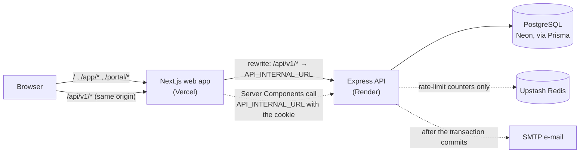
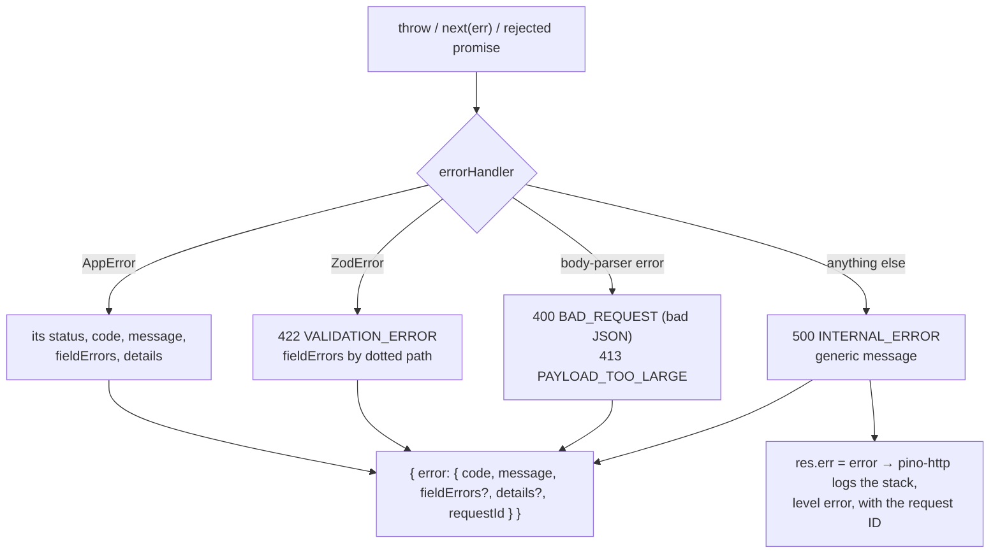

# FixFlow — Architecture

How FixFlow is put together and why. This is a living document: each task adds the sections for what it builds. The canonical requirements are in the specification (§13 describes the architecture); decisions are in [DECISIONS_AND_OPEN_QUESTIONS.md](DECISIONS_AND_OPEN_QUESTIONS.md). The HTTP contract is in [API.md](API.md).

**Covered so far:** system overview, API layering, module conventions, dependency injection, middleware order, error flow, configuration, logging, rate limiting and the test harness (T02). Later tasks add the data model (T03), authentication flows (T05), e-mail (T06) and the rest.

## 1. System overview

FixFlow serves **one** small home-service business. It is a single Next.js application with three experiences (public website, admin dashboard at `/app/*`, customer portal at `/portal/*`) in front of a single Express API and a PostgreSQL database. There is no multi-tenancy.



- **The server is authoritative** for authentication, roles, ownership, validation, totals, references, status transitions and timestamps. The web app has no database access and no business rules beyond display hints.
- **The browser only talks to the web origin.** Next.js rewrites `/api/v1/*` to the API, so the session cookie is first-party (D-06). CORS on the API is defence in depth.
- Solid lines exist today (web ↔ API through the rewrite). The database arrives in T03, sessions in T05, e-mail in T06; Redis is used for rate limiting only (D-12).

## 2. Repository layout

```text
apps/web/          Next.js app (App Router, Tailwind CSS)
apps/server/       Express 5 API
packages/shared/   @fixflow/shared — error codes, limits, envelope types (no I/O, no framework code)
e2e/               Playwright end-to-end tests
```

`@fixflow/shared` compiles to `dist/`, and both apps import that output (D-54), so the root scripts build it first.

## 3. API layering

```text
apps/server/src/
  server.ts          process entry: load .env (dev), validate config, build deps, listen, shut down
  app.ts             createApp(deps): wires middleware and routers in a fixed order
  deps.ts            AppDeps + createProductionDeps(config)
  config/            env.ts (Zod-validated, frozen Config), dotenv.ts (local .env loader)
  lib/               logger, errors, zod-errors, pagination, clock, shutdown, rate-limit/
  middleware/        request-id, rate-limit, validate, not-found, error-handler
  modules/<module>/  one folder per domain module (today: health)
  test/              test harness: buildTestApp, log capture, throwaway routes (not built)
```

Each layer only depends downward:

| Layer                 | Responsibility                                                                                  | May use                      |
| --------------------- | ----------------------------------------------------------------------------------------------- | ---------------------------- |
| Routes (`*.routes.ts`) | HTTP only: mount `validate(...)`, call a service, serialize the result with `{ data }`.        | middleware, service, dto     |
| Service (`*.service.ts`) | Business logic and transactions. Throws `AppError`s.                                         | domain, Prisma, other services |
| Domain (`*.domain.ts`) | Pure rules: status transitions, calculations. No I/O. Status changes happen only here.         | `@fixflow/shared`            |
| DTO (`*.dto.ts`)       | Serializers. Customer-facing and admin serializers are separate functions.                     | —                            |

The platform pieces in `lib/` and `middleware/` know nothing about any domain module.

### Module file conventions

A module is created only when a task needs it, and uses these files:

| File                | Contents                                                              |
| ------------------- | --------------------------------------------------------------------- |
| `<m>.routes.ts`     | Express `Router` and route handlers                                   |
| `<m>.schemas.ts`    | Zod schemas for params, query and body (bodies are `z.strictObject`)  |
| `<m>.service.ts`    | Business logic, transactions, throws `AppError`                        |
| `<m>.domain.ts`     | Pure rules (transitions, calculations)                                |
| `<m>.dto.ts`        | Response serializers                                                  |
| `*.test.ts`         | Unit tests, next to the code                                          |
| `*.int.test.ts`     | Integration tests (Supertest + test database, from T03)               |

A typical route:

```ts
const schemas = {
  params: z.object({ id: z.uuid() }),
  body: z.strictObject({ note: z.string().max(LIMITS.notes.maxLength) }),
};

router.post("/:id/notes", validate(schemas), async (req, res) => {
  // req.params and req.body are the parsed, typed values
  const note = await notesService.add(deps, req.params.id, req.body);
  res.status(201).json({ data: toNoteDto(note) });
});
```

Handlers may be `async`: Express 5 forwards a rejected promise to the error handler, so there is no `try/catch` boilerplate.

## 4. Dependency injection

There is no DI framework, only a typed object passed explicitly:

```ts
interface AppDeps {
  config: Config;          // validated, frozen environment configuration
  clock: Clock;            // now(); a FakeClock in tests
  logger: Logger;          // pino
  rateLimiter: RateLimiter; // Upstash in production, in-memory locally and in tests
  rateLimits: RateLimitTable; // the named limits in force (multiplier applied)
}
```

- `server.ts` builds the production object with `createProductionDeps(config)`; tests build theirs with `buildTestDeps()` / `buildTestApp()`, substituting fakes.
- Later tasks add the Prisma client, the e-mail sender and the Google ID-token verifier to `AppDeps`. Anything time-dependent takes the `Clock` (expiry, overdue, scheduling, rate-limit windows) so tests are deterministic.
- Nothing reads `process.env` after startup, and nothing reaches for a global singleton.

## 5. Middleware order

`createApp` mounts middleware in this order. The order is deliberate; changing it changes behaviour.

| # | Middleware             | Why it sits here                                                                                                   |
| - | ---------------------- | ------------------------------------------------------------------------------------------------------------------ |
| 1 | `requestId`            | First, so every later log line and **every** response (including errors and 429s) carries the ID.                  |
| 2 | request logger (pino-http) | Needs the ID; logs one line when the response finishes, so it sees the final status of everything after it.     |
| 3 | `helmet`               | Security headers on every response, including errors raised later.                                                 |
| 4 | `cors`                 | Answers preflight `OPTIONS` requests before they can be counted, parsed or rejected by anything below.             |
| 5 | `express.json` (100 kb, strict) | Parses the body once for all routes. Oversized or malformed bodies become `413` / `400` through the error handler. |
| 6 | global rate limit      | Per-IP ceiling for the whole API. After CORS, so preflights do not consume the allowance.                          |
| 7 | routers                | `/api/v1/health`, then each module's router.                                                                       |
| 8 | `notFoundHandler`      | Anything no route matched becomes a `404 NOT_FOUND` error.                                                         |
| 9 | `errorHandler`         | Last: the single place errors turn into responses.                                                                 |

Two settings are applied before the chain: `x-powered-by` is disabled and `trust proxy` is taken from configuration, so `req.ip` is the real client when the API runs behind a load balancer.

Later tasks add (T05) session loading and the CSRF `Origin` check, positioned after body parsing and the global limit, and per-route guards and named rate limits on individual routes.

Body parsing runs before the global rate limit, as specified for T02. The cost is bounded by the 100 kb limit; moving the rate limit ahead of parsing would reject abusive clients slightly more cheaply and is a one-line reorder (D-57).

## 6. Error flow

Expected failures are `AppError`s thrown (or passed to `next`) anywhere below the error handler. The central handler is the only code that writes an error response.



- `AppError` has helper constructors, one per status: `badRequest`, `unauthorized`, `forbidden`, `notFound`, `conflict`, `payloadTooLarge`, `validation`, `rateLimited`. `ErrorCode` lives in `@fixflow/shared`, so the web app and the API share one vocabulary.
- A `ZodError` thrown directly (for example from `schema.parse` inside a service) is handled exactly like a validation failure from `validate()`.
- An unexpected error is logged **with its stack** (pino-http's completion line, level `error`) and answered with a generic message. Nothing about the cause reaches the client.
- Client errors (`4xx`) are logged at `warn` without a stack; successes at `info`.
- If the response has already started, the handler delegates to Express, which closes the connection.

## 7. Configuration

`config/env.ts` validates every environment variable once at startup and exports a frozen, typed `Config`. `server.ts` exits with status `1` if validation fails.

- The error lists variable **names** and a fixed description of what is expected, never the values (a malformed secret must not reach a log).
- Production adds requirements that development does not have: `WEB_ORIGIN`, the Upstash credentials, and `RATE_LIMIT_MULTIPLIER=1`.
- Tests never read real env files: `buildTestConfig()` passes an explicit object to the same `loadConfig` used in production.
- `.env` is loaded in development and test only, and never overrides a variable that is already set.

All variables are documented, with comments, in `apps/server/.env.example`. Later tasks extend the Zod schema.

## 8. Logging

pino with pino-http. One JSON line per request in production; pretty output in development only.

- **Redaction** removes `req.headers.cookie`, `req.headers.authorization`, `res.headers["set-cookie"]`, and any field named `password`, `newPassword`, `currentPassword`, `credential`, `token` or `secret` at up to four levels of nesting.
- **Not logged:** request or response bodies, query strings (only the path), and response headers (only the status code).
- Handlers log with `req.log`, which carries the request ID.

## 9. Rate limiting

```text
RateLimiter.consume(key, { limit, windowSeconds }) → { success, remaining, resetAt }
```

- `MemoryRateLimiter` keeps a sliding window per key in process memory, driven by the injected `Clock` (so tests move time, not wait). Idle keys are swept. It is for development and tests.
- `UpstashRateLimiter` wraps `@upstash/ratelimit`'s sliding window over Upstash's REST API. That library fixes the limit and window per instance, so one instance is created and reused per distinct rule.
- `rateLimit({ name, limit, windowSeconds, key })` is the middleware factory. Counter keys are `<name>:<key>`, so limits never share a counter. `rateLimitByName(deps, name, key)` takes the rule from the `RATE_LIMITS` map (after the multiplier), which is the single place every limit is defined.
- A rejected request gets `429 RATE_LIMITED` with `Retry-After`. If the limiter store itself fails, the request is allowed and the failure is logged (D-57).

## 10. Test harness

`apps/server/src/test/` (excluded from the build):

| File                | Purpose                                                                                                |
| ------------------- | ------------------------------------------------------------------------------------------------------ |
| `build-test-app.ts` | `buildTestApp(overrides)` returns `{ app, deps, clock, logs }`: real app, `FakeClock`, in-memory limiter, captured logs, rate limits scaled up. |
| `test-routes.ts`    | Throwaway routes under `/api/v1/__test__` that throw each error type, exercise `validate`, pagination, logging and a named rate limit. Mounted only when a test asks (`testRoutes: true`); production never loads them. |
| `log-capture.ts`    | Collects pino output so tests can assert on what was and was not logged.                              |
| `http.ts`           | `expectApiError(response, { status, code })` asserts the error contract; `bodyOf<T>()` types a response body. |

Vitest separates two suites: `npm run test` runs `*.test.ts` (unit and Supertest tests with no external services), and `npm run test:integration -w @fixflow/server` runs `*.int.test.ts` (used from T03, when a test database exists).

## 11. Not covered yet

Data model and migrations (T03), authentication, sessions and CSRF (T05), activity and e-mail (T06), and the web application structure (T04 onwards) are documented by the tasks that build them.
