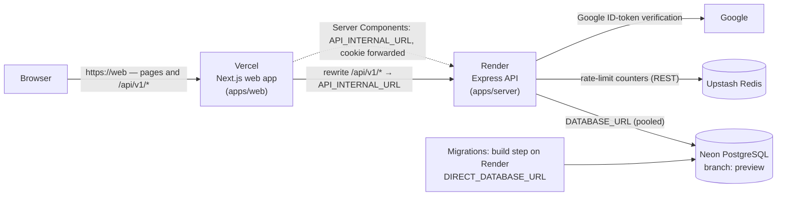

# FixFlow — Deployment

How the hosted environments are built and operated: the preview and the public production demo. Production has the same shape as the preview; what differs is the Neon branch, real email and the checks that are run (section 11, which is also the operations runbook). No value in this document is a real secret: placeholders are written `<like-this>`.

## 1. Architecture of the hosted environments



- **The browser only ever talks to the web origin**. `*.vercel.app` and `*.onrender.com` are different registrable sites, so a cookie set by the API's own domain would be a third-party cookie that Safari and Firefox block. `/api/v1/*` on the web origin is rewritten to the API, so the session cookie (`__Host-fixflow_session`) is first-party to the web origin.
- **CORS and CSRF.** The API allows only `WEB_ORIGIN` and rejects an unsafe request whose `Origin` is not `WEB_ORIGIN` (403). The rewrite must therefore preserve the browser's `Origin`; section 8 records that it does.
- **Neon branches**: `main` is the future production demo, `dev` is local development, `preview` is the hosted preview. The preview database is a separate branch and is never shared with development or production.
- **Email** on a deployment without a mail server is `EMAIL_TRANSPORT=log`: nothing is delivered, so password reset is unavailable there (section 9). Production uses `EMAIL_TRANSPORT=smtp` (section 11.4); mail to the seeded reserved `.test` addresses is still only logged.

## 2. Files

| File | Purpose |
|---|---|
| [`render.yaml`](../render.yaml) | Render Blueprint for the API: build, start, health check and every environment variable key. |
| [`apps/web/vercel.json`](../apps/web/vercel.json) | Vercel install command and the build command (`node scripts/vercel-build.mjs`; Vercel limits `buildCommand` to 256 characters). |
| [`apps/web/scripts/vercel-build.mjs`](../apps/web/scripts/vercel-build.mjs) | The Vercel build: builds `@fixflow/shared`, wakes the API (up to 6 tries, 10 s apart; never fails the build), then runs `next build`. |
| [`apps/web/next.config.ts`](../apps/web/next.config.ts) | Reads `API_INTERNAL_URL` at **build** time; a Vercel build without it fails on purpose. |
| [`e2e/playwright.config.ts`](../e2e/playwright.config.ts) | With `BASE_URL` set, runs the `@smoke` tests against a hosted URL (Chromium and WebKit). |

## 3. Environment variables

Secrets are marked **yes**. "Where" is the provider setting that holds the value.

### 3.1 Render — API service `fixflow-api`

| Variable | Example format | Secret | Notes |
|---|---|---|---|
| `NODE_VERSION` | `24` | no | Set in `render.yaml`. |
| `NODE_ENV` | `production` | no | Set in `render.yaml`. Enables the `__Host-` cookie, strict config and fail-fast startup. |
| `LOG_LEVEL` | `info` | no | Set in `render.yaml`. |
| `TRUST_PROXY` | `4` | no | Number of proxy hops in front of the API. **4** was measured behind Vercel and Render (section 8.4). |
| `DATABASE_URL` | `postgresql://<user>:<password>@<endpoint>-pooler.<region>.aws.neon.tech/<db>?sslmode=verify-full` | **yes** | Neon **pooled** string (host contains `-pooler`): branch `preview` for the preview, branch `main` for production (never shared between environments). |
| `DIRECT_DATABASE_URL` | `postgresql://<user>:<password>@<endpoint>.<region>.aws.neon.tech/<db>?sslmode=verify-full&connect_timeout=30` | **yes** | Neon **direct** string (no `-pooler`). Used only by `prisma migrate deploy` in the build. `connect_timeout=30` is needed: Prisma gives up after 5 s by default and a suspended Neon compute can take longer to wake (P1001). |
| `WEB_ORIGIN` | `https://<web>.vercel.app` | no | Scheme and host only: no path, no trailing slash. Must equal the address in the browser's address bar. |
| `PUBLIC_WEB_URL` | `https://<web>.vercel.app` | no | Used for absolute links in emails. |
| `SESSION_SECRET` | generated | **yes** | Render generates it (`generateValue`). Changing it signs everyone out. |
| `GOOGLE_CLIENT_ID` | `<number>-<id>.apps.googleusercontent.com` | no | A client ID is not a secret. Same value as `NEXT_PUBLIC_GOOGLE_CLIENT_ID`. |
| `ADMIN_EMAILS` | `admin@demo.fixflow.test,<your-google-address>` | no | Comma-separated. Includes the seeded demo admin and the Google account that should become an administrator. |
| `DEMO_MODE` | `true` | no | The public demo: the shared demo accounts cannot change their password, the business identity is locked for the demo admin, and the demo write and sign-up limits apply (section 6a). Set `NEXT_PUBLIC_DEMO_MODE` on Vercel to match. |
| `PUBLIC_SIGNUP_ENABLED` | `true` | no | `false` closes registration (local and Google) without a code change; existing accounts keep working. |
| `UPSTASH_REDIS_REST_URL` | `https://<name>-<id>.upstash.io` | no | From the Upstash database page. |
| `UPSTASH_REDIS_REST_TOKEN` | `<token>` | **yes** | Use the read-write token. |
| `EMAIL_TRANSPORT` | `smtp` | no | Set in `render.yaml` (production). `log` writes nothing to disk and delivers nothing (a throwaway preview). |
| `EMAIL_FROM` | `CoolBreeze Home Services <hello@<your-domain>>` | no | A sender your SMTP provider has verified. Production refuses to start without it when the transport is `smtp`. |
| `SMTP_HOST` | `<smtp.provider.example>` | no | Production needs all six `SMTP_*` / `EMAIL_FROM` values with `smtp`; the log names any that are missing (never values). |
| `SMTP_PORT` | `587` | no | 587 with STARTTLS, or 465 with `SMTP_SECURE=true`. |
| `SMTP_SECURE` | `false` | no | `true` is TLS from the first byte (465); `false` is STARTTLS (587), and production refuses a server that cannot upgrade to TLS. |
| `SMTP_USER` | `<smtp-user>` | **yes** (treat as one) | Goes with `SMTP_PASSWORD`. |
| `SMTP_PASSWORD` | `<smtp-password or API key>` | **yes** | Rotating it: section 11.6. |

The seed's `DEMO_ADMIN_PASSWORD` and `DEMO_CUSTOMER_PASSWORD` are **not** set on Render: the API never reads them, and Render's free plan has no shell. The seed runs from a developer machine (section 6).

### 3.2 Vercel — project `fixflow-preview` (root directory `apps/web`)

Set these for the **Production** environment (and Preview, if branch deployments are used).

| Variable | Example format | Secret | Notes |
|---|---|---|---|
| `API_INTERNAL_URL` | `https://<api>.onrender.com` | no | Server-only. **Build-time**: the rewrite destination is compiled in, so changing it needs a redeploy. No trailing slash. |
| `NEXT_PUBLIC_GOOGLE_CLIENT_ID` | same as `GOOGLE_CLIENT_ID` | no | Public by design; compiled into the bundle. |
| `NEXT_PUBLIC_DEMO_MODE` | `true` | no | Shows the demo panel on the sign-in page and the portfolio banner, and asks search engines not to index the site. |
| `NEXT_PUBLIC_DEMO_ADMIN_PASSWORD` | `<demo-admin-password>` | no, **published on purpose** | Must equal the password the seed used. Choose values that are not the ones in `.env.example`. |
| `NEXT_PUBLIC_DEMO_CUSTOMER_PASSWORD` | `<demo-customer-password>` | no, **published on purpose** | Same. |
| `SITE_URL` | `https://<web>.vercel.app` | no | Optional: canonical links and the sitemap fall back to `VERCEL_PROJECT_PRODUCTION_URL`. The variable is named `SITE_URL` (not `NEXT_PUBLIC_SITE_URL`). |
| `PUBLIC_REVALIDATE_SECONDS` | `60` | no | Optional; how long the public pages hold what they read from the API. |

### 3.3 A developer machine — only to seed the preview

| Variable | Notes |
|---|---|
| `DATABASE_URL`, `DIRECT_DATABASE_URL` | The Neon `preview` strings. Set them in the shell for one command; never in a committed file. |
| `DEMO_ADMIN_PASSWORD`, `DEMO_CUSTOMER_PASSWORD` | The same two passwords as in Vercel. |

## 4. First-time setup

Names used below (`fixflow-api`, `fixflow-preview`) are the ones in `render.yaml` and this document. If a provider gives you a different host name (the name was taken), use the real one everywhere the placeholders appear.

### 4.1 Code on GitHub
Render and Vercel deploy from the repository (`main`). Push the commit that contains `render.yaml` and `apps/web/vercel.json`.

### 4.2 Neon
1. In the Neon project create a branch named `preview` (from `main` or `dev`; the schema is created by the migrations, so an empty branch is fine).
2. Open **Connect** for that branch and copy two strings: pooled (toggle *Connection pooling* on) and direct (off). Remove `&channel_binding=require` if present and use `?sslmode=verify-full` (equivalent to `require` with the installed driver, without its one-off warning).
3. The database name and role are the ones Neon created for the project.

### 4.3 Upstash
Create a Redis database in the region nearest Render (and Neon). From its **REST API** panel copy `UPSTASH_REDIS_REST_URL` and the read-write `UPSTASH_REDIS_REST_TOKEN`.

### 4.4 Google OAuth
In Google Cloud Console → APIs & Services → Credentials, open the OAuth 2.0 **Web** client and add `https://<web>.vercel.app` under **Authorized JavaScript origins** (no path, no trailing slash). No redirect URI is needed: sign-in uses Google's ID-token button. If the consent screen is in *Testing*, only listed test users can sign in, so add the accounts you will try (one that is in `ADMIN_EMAILS` and one that is not), or publish the consent screen.

### 4.5 Render (API)
The service's **region must be the one nearest the Neon branch**, and it cannot be changed after the service is created. `render.yaml` says `singapore` (the preview's Neon endpoint is `ap-southeast-1`); edit it before step 1 if your Neon region is different. A service in another region still works but every query crosses an ocean, and slow connects make the migration step fail (below).

1. **New → Blueprint**, pick the repository and branch `main`. Render reads `render.yaml`.
2. Fill in the prompted values: `DATABASE_URL`, `DIRECT_DATABASE_URL`, `WEB_ORIGIN`, `PUBLIC_WEB_URL`, `GOOGLE_CLIENT_ID`, `ADMIN_EMAILS`, `UPSTASH_REDIS_REST_URL`, `UPSTASH_REDIS_REST_TOKEN`. Use the predicted web address for `WEB_ORIGIN` and `PUBLIC_WEB_URL`; correct them later if Vercel assigns a different one.
3. Create. The first build runs `npm ci`, builds `@fixflow/shared`, applies the migrations to Neon and compiles the API (about 3–5 minutes). A failed migration fails the build and nothing is deployed.
4. Note the service URL (`https://<api>.onrender.com`) and check `https://<api>.onrender.com/api/v1/health`.

### 4.6 Vercel (web)
1. **Add New → Project**, import the repository.
2. **Root Directory:** `apps/web` (leave *Include source files outside of the Root Directory* on). Framework: Next.js. Node.js version: 24.x. The install and build commands come from `apps/web/vercel.json`.
3. Environment variables: section 3.2. `API_INTERNAL_URL` must be set **before** the first deploy or the build fails by design.
4. Deploy. Note the production domain and make sure it is what `WEB_ORIGIN` on Render says.

### 4.7 Seed the preview database
See section 6.

## 5. Migrations

Migrations run in the Render **build** (`npm run db:deploy -w @fixflow/server`, with `DIRECT_DATABASE_URL`), because pre-deploy commands are not available on every Render plan. Consequences:
- A new commit that adds a migration applies it to Neon before the new code starts; a failing migration fails the build and the previous deploy keeps serving.
- Migrations are forward-only. Write them so the previous release still works against the new schema (add columns as nullable or with defaults, drop in a later release).
- Author migrations locally on Docker (`npm run db:migrate -- --name <change>`) and never edit one that has been applied.

## 6. Seeding and resetting the preview

**Seed** (idempotent; creates settings, five services, three demo accounts, two addresses, three technicians). From a developer machine, with the Neon `preview` strings:

```bash
# bash; PowerShell: $env:NAME = "value"
DATABASE_URL='<neon preview pooled>' DIRECT_DATABASE_URL='<neon preview direct>' \
DEMO_ADMIN_PASSWORD='<demo-admin-password>' DEMO_CUSTOMER_PASSWORD='<demo-customer-password>' \
npm run db:seed
```

Run it after the first successful Render deploy (the migrations must exist). The passwords must equal `NEXT_PUBLIC_DEMO_ADMIN_PASSWORD` / `NEXT_PUBLIC_DEMO_CUSTOMER_PASSWORD` in Vercel. Running it again with a new password updates the hash.

**Reset** the preview to a clean state: in Neon, reset or recreate the `preview` branch (or run `DROP SCHEMA public CASCADE; CREATE SCHEMA public;` on it), then trigger a Render deploy (**Manual Deploy → Clear build cache & deploy**) so the migrations run again, then seed. Only ever do this to the `preview` branch.

## 6a. The demo's data: showcase, reset and safeguards

### What is in the demo

`npm run db:seed:demo` loads the base seed and then the **showcase**: 8 customers (the two demo customers and six more who cannot sign in), 4 technicians, 20 requests, 19 quotations, 13 jobs, 6 invoices and 3 payments, with every status of every entity at least once, a history and notifications. Every record is made by the application's own services, and every date is **relative to the moment it runs** in the business's time zone, so the demo always shows jobs this week and invoices due or overdue relative to today. `npm run db:verify-demo` checks 18 rules and exits non-zero on any violation. `npm run db:seed:demo` runs it for you and refuses to add to a business that already has requests.

### The reset command

`npm run db:reset-demo` **empties the database** and loads the base seed and the showcase again, then runs the checker. It is guarded and does nothing unless all of these hold:

| Guard | Why |
|---|---|
| `DEMO_MODE=true` | only an environment that says it is the public demo may be reset |
| `CONFIRM_DEMO_RESET` is exactly the database name in `DATABASE_URL` | typing the name proves whoever runs it knows which database is about to be emptied |
| `NODE_ENV` is not `test`, and the database is not the one `TEST_DATABASE_URL` or `E2E_DATABASE_URL` names | those have their own reset behind their own guards |
| the live connection is on the confirmed database (`current_database()`) | checked before anything is deleted |

It prints the **host and database name** before it acts, never a credential. It needs both `DEMO_*_PASSWORD` values (the demo accounts are created again with them, so this is also how a password is rotated). It does not run migrations: change the schema deliberately with `npm run db:deploy`.

```bash
# bash; PowerShell: $env:NAME = "value"
DEMO_MODE=true CONFIRM_DEMO_RESET=<the demo database's name> DATABASE_URL='<neon demo pooled>' DEMO_ADMIN_PASSWORD='<demo-admin-password>' DEMO_CUSTOMER_PASSWORD='<demo-customer-password>' npm run db:reset-demo
```

It takes about ten seconds on a local database and longer over the internet (every step is several queries). Running it twice gives the same structure, with the dates counted from the new run. Visitors' accounts and anything they entered are removed.

### The scheduled reset (a GitHub Actions workflow, off until the owner enables it)

`.github/workflows/reset-demo.yml` runs the same command on `workflow_dispatch` and once a day at **13:15 UTC** (08:15 or 09:15 in New York, so the showcase's "visit in progress today" is plausible all day; change the cron line for another business time zone). **It is disabled by default**: the job is skipped unless the repository variable `DEMO_RESET_ENABLED` is `true`. To enable it:

1. **Settings → Secrets and variables → Actions → Secrets:** `DEMO_DATABASE_URL` (the Neon **pooled** string of the demo database), `DEMO_ADMIN_PASSWORD`, `DEMO_CUSTOMER_PASSWORD` (the same values as in Vercel's `NEXT_PUBLIC_DEMO_*_PASSWORD`).
2. **Variables:** `DEMO_DATABASE_NAME` (the demo database's name, which becomes `CONFIRM_DEMO_RESET`) and `DEMO_RESET_ENABLED=true`.
3. Run the workflow once by hand (**Actions → Reset demo data → Run workflow**) and read the log: the first lines name the host and database; the last say "All 18 checks passed."

A scheduled workflow only runs from the default branch, and GitHub pauses it after 60 days without repository activity (re-enable it from the Actions tab). The banner and the privacy page say "Data resets daily", which is true only while this workflow is enabled: **the workflow must be enabled and a run confirmed**, or that wording changed.

### What demo mode does (`DEMO_MODE=true`)

| Safeguard | Behaviour |
|---|---|
| Passwords | the shared demo accounts cannot change or reset them (`403 DEMO_ACCOUNT_LOCKED`) |
| Business identity | the shared demo admin cannot change the business name, tagline, logo, contact email, phone, address or service area (`403 DEMO_ACCOUNT_LOCKED`); the settings form shows them read-only with an explanation. The owner's own admin account (in `ADMIN_EMAILS`) is not locked. Everything else (services, prices, tax, terms) stays editable and is put back by the reset |
| Writes | a shared demo account may make 60 writes in 10 minutes per account and IP address; more is `429 RATE_LIMITED` with `Retry-After`. Reading is not limited |
| New accounts | 3 local registrations an hour per IP address (on top of the usual 5) |
| `PUBLIC_SIGNUP_ENABLED=false` | closes registration entirely (`403 SIGNUP_DISABLED`); existing accounts keep working. Use it if the demo is abused |
| Email | every showcase address is a reserved `.test` address, so email to it is logged and never sent; a visitor who registers a real address receives only their own emails, when SMTP is configured |
| Notices | the banner (public pages and both signed-in areas), the sign-in and registration pages, and `/privacy` tell visitors to use fictional details, that the data resets daily and what is locked |

### Rotating the demo credentials

If the published credentials are abused: (1) set `PUBLIC_SIGNUP_ENABLED=false` on Render if sign-up is the problem; (2) choose new demo passwords, update `NEXT_PUBLIC_DEMO_ADMIN_PASSWORD` and `NEXT_PUBLIC_DEMO_CUSTOMER_PASSWORD` on Vercel and redeploy the web app; (3) run the reset (or `npm run db:seed`, which replaces a password that no longer matches) with the new `DEMO_*_PASSWORD` values; sessions of the old credentials are removed by the reset. The shared admin cannot be used to change its own password, so rotation is always this procedure.

### Limits to know about

- The reset removes everything, including a settings change made through the admin screens; change a default permanently in `apps/server/src/db/seed-data.ts`.
- The demo is only as current as its last reset: "today" in the showcase is the day of the last run. After midnight in the business's time zone and before the next reset, "today's visit" is yesterday's.
- A reset run before about 08:05 in the business's time zone shows the in-progress job as started a few minutes before the run, ahead of its booked 08:00 time.
- The upstash rate-limit counters are not reset; they expire by themselves.

## 7. Rolling back

- **API (Render):** Dashboard → the service → **Events** / **Deploys** → pick the previous successful deploy → **Rollback**. This restores the code, **not** the database.
- **Web (Vercel):** Dashboard → **Deployments** → open the previous deployment → **Instant Rollback** (promote it to production). `API_INTERNAL_URL` is compiled into each deployment, so a rolled-back deployment keeps pointing where it did.
- **Database:** migrations are forward-only. To undo a bad migration restore the Neon branch to an earlier point in time (Neon **Restore**) or reset the preview (section 6). Do the code rollback and the database restore together.

## 8. Verification record

Measured on the hosted preview on 2026-10-30. Hosts are written `<web>` (Vercel) and `<api>` (Render); the visitor's own address is shown as `<client>`. Sections 8.1 to 8.5 were measured before the database was seeded; 8.6 and 8.7 record the checks after it.

### 8.1 Health

| Check                                             | Result                                                                                                                       |
| ------------------------------------------------- | ---------------------------------------------------------------------------------------------------------------------------- |
| `GET <api>/api/v1/health`                         | **200** `{"data":{"status":"ok"}}`                                                                                           |
| `GET <api>/api/v1/health/ready`                   | **200** `{"data":{"status":"ready"}}` (the API reaches Neon)                                                                 |
| `GET <web>/api/v1/health` (through the rewrite)   | **200**, the same body; the response carries `X-Render-Origin-Server: Render` and `Server: Vercel`, so the API answered it   |
| `GET <web>/api/v1/health/ready`                   | **200**                                                                                                                      |

### 8.2 Migrations and the build

The Render build applied both migrations to the Neon database. The first attempt failed with `P1001` (section 10); after the region, `connect_timeout` and retry changes the build succeeded. The API then failed to start on a mistyped `UPSTASH_REDIS_REST_URL` until it was corrected.

### 8.3 Origin, CSRF and headers through the rewrite

| Request through `<web>`                                         | Result                                                                          |
| --------------------------------------------------------------- | ------------------------------------------------------------------------------- |
| `POST /api/v1/auth/login`, `Origin: https://evil.example`       | **403**                                                                         |
| the same with no `Origin`                                       | **403**                                                                         |
| the same with `Origin: <web>`, unknown email                    | passes the CSRF check and reaches the credentials check (`INVALID_CREDENTIALS`) |

So the browser's `Origin` survives the rewrite and the check works behind two proxies. _Pending:_ the `Set-Cookie` header of a real sign-in (needs the seed), checked by `preview-smoke.spec.ts`.

### 8.4 Client address and `TRUST_PROXY`

A temporary route (since removed) showed what the API receives for a request from a visitor:

```text
socket (remote address)   ::1                      Render's local proxy
X-Forwarded-For           <client>, <vercel-egress>, <cloudflare>, <render-lb-private>
X-Vercel-Forwarded-For    <client>
CF-Connecting-IP          <vercel-egress>          (Cloudflare sees Vercel as the caller)
```

- With `TRUST_PROXY=1` (the production default) `req.ip` was Render's **private load-balancer address** (`10.x`), the same for every visitor. Every per-IP rate limit (global, sign-in, registration, password reset) would have shared one counter, so a single abusive visitor could lock everyone out.
- The real client is **four hops out**, so `TRUST_PROXY=4` gives it. This is set in `render.yaml`.
- **A visitor cannot forge the address through the website.** A request sent to `<web>` with `X-Forwarded-For: 9.9.9.9` and `X-Vercel-Forwarded-For: 8.8.8.8` reached the API with both replaced by the real address.
- **A caller who bypasses the website can.** A request sent straight to `<api>` with its own `X-Forwarded-For` carries that value as the first entry (`<spoofed>, <client>, <cloudflare>, <render-lb>`), and with 4 trusted hops the spoofed entry becomes `req.ip`. An honest direct request (no header of its own) is keyed correctly. This only weakens the per-IP limits for someone who calls the API URL directly; the per-address limits (password reset: 3 per hour per email) and Argon2id's cost still apply. Closing it needs the API to accept traffic only from the web app (a shared secret added by a route-handler proxy, or a paid private network). Closing it is a recorded follow-up for the production release.
- If the platforms add or remove a hop the count must be measured again: temporarily re-add a route that echoes `req.ip`, `req.ips` and `X-Forwarded-For`, and remove it afterwards.

_Pending:_ after setting `TRUST_PROXY=4` on Render, a repeat of the debug request must return the visitor's address as `ip`; then the sixth failed sign-in for one address and email must return **429** with `Retry-After`, and the `fixflow:ratelimit:*` keys must appear in Upstash's data browser.

### 8.5 Public site

`<web>/` and `/services` answer 200 with the "We can't show … right now" notice, because the API answers `503 "The business settings have not been set up yet"` until the database is seeded (section 6). This is the designed fallback, not an error. The pages refresh within `PUBLIC_REVALIDATE_SECONDS` (60 s) of the first visit after the seed.

### 8.6 After the seed (2026-10-30)

| Check | Result |
|---|---|
| Seed of the Neon database from a developer machine (section 6) | Created settings, 5 services, 3 demo accounts, 2 addresses, 3 technicians. The seed rejected the first passwords tried (a common password; 9 characters), as designed. |
| Public pages | `/`, `/services`, `/privacy` → 200 with the business content, not the fallback notice. `<api>/settings/public` and `/services` → 200. |
| Client address | With `TRUST_PROXY=4` the debug route returned the visitor's own address as `ip`. |
| Sign-in cookie on the wire | `Set-Cookie: __Host-fixflow_session=…; Path=/; HttpOnly; Secure; SameSite=Lax` from `<web>/api/v1/auth/login`. |
| Chromium and WebKit, customer sign-in through the form | Pass: lands in `/portal`. |
| Chromium and WebKit, CSRF through the proxy (foreign Origin 403, no Origin 403, right Origin 401) | Pass. |
| 429 | Failed sign-ins for one address and email: 401 five times, then `429` with `Retry-After` (about 5 minutes). The counters live in Upstash. |
| Password-reset request | `503 PASSWORD_RESET_UNAVAILABLE` for a known and an unknown address alike. Not an error: the preview has no email. |
| Admin sign-in | The login succeeds, but `GET /auth/me` → `403 "This account no longer has administrator access"`: `admin@demo.fixflow.test` is not in Render's `ADMIN_EMAILS` (the server accepts no admin outside the list). Fix: add it to the Render variable (section 3.1). Fixed afterwards: see 8.7. |

WebKit's cookie jar (Playwright on Windows) reports `SameSite=Lax` as `None`, so the smoke test reads `SameSite` from the `Set-Cookie` header instead; the other attributes are checked in the browser.

### 8.7 Closing the remaining checks

Nothing is pending for the preview. The last items were closed on 2026-10-30:
- **Google sign-in** in the owner's browser (an allow-listed admin, and a regular customer): works (owner-reported). The first redeploy had no `NEXT_PUBLIC_GOOGLE_CLIENT_ID` and the login page said "Google sign-in isn't set up on this site yet"; set it in Vercel and redeploy without the build cache.
- **Upstash:** the owner saw the `fixflow:ratelimit:*` keys.
- **Cold start:** after 17 minutes idle the public home page answered 200 in 2.2 s with the business content and no notice, on five probes over three minutes and on `/services`. Vercel's cache served the pages, so the API's own wake-up time was not observed; the "API unreachable" fallback is covered by the public-site end-to-end tests.

Done after `ADMIN_EMAILS` was fixed (2026-10-30): `/auth/me` → 200 for the admin, and all 10 `@smoke` tests pass in Chromium and WebKit (admin and customer sign-in, cookie attributes, CSRF through the proxy, home page, health). The temporary debug route is removed.

## 9. Cold starts and the free Render plan

- A Render **free** web service sleeps after about 15 minutes without traffic; the first request after that waits roughly a minute while it starts. Neon's compute also suspends when idle and wakes in about a second.
- The public website tolerates this: when the API does not answer, the pages show a message with a retry instead of an error page, and recover on the next load. `/login` and the signed-in areas show a retryable error.
- The Vercel build wakes the API first (`scripts/vercel-build.mjs`), because a build made while the API is asleep bakes the "we can't show this right now" notice into the prerendered pages until they are first visited. If you see that notice after a deploy, wait about ten seconds and reload.
- For the public demo use a paid Render instance: no sleeping.
- **Password reset is unavailable on the preview.** With `NODE_ENV=production` and `EMAIL_TRANSPORT=log` the API writes no message bodies and never logs a reset token, so a reset link cannot be read anywhere. Set `EMAIL_TRANSPORT=smtp` and the `SMTP_*` variables to deliver email.

## 10. Troubleshooting

| Symptom | Likely cause and fix |
|---|---|
| Vercel: "`buildCommand` should NOT be longer than 256 characters" | Keep the build logic in `apps/web/scripts/vercel-build.mjs` and the command short. |
| Vercel build fails: "API_INTERNAL_URL is not set" | Add the variable to the Vercel project and redeploy (section 3.2). |
| Render build fails in `db:deploy` with `P1001: Can't reach database server` | The Neon compute was suspended and Prisma's 5 s connect timeout expired, or the service is in a far-away region. Add `&connect_timeout=30` to `DIRECT_DATABASE_URL` (the build also retries once after 20 s), and keep the Render region next to Neon. If it persists, check the Neon project's *IP Allow* setting (a restricted list blocks Render) and that the branch has a running compute endpoint. |
| Render build fails in `db:deploy` (any other error) | `DIRECT_DATABASE_URL` is wrong, or is the pooled string. Use the host **without** `-pooler`. Check the Neon branch exists and is not suspended past its limits. |
| Every visitor shares one rate limit, or unrelated people get "too many requests" | `TRUST_PROXY` is lower than the number of proxies, so the API sees an internal address. It must be `4` here (section 8.4). |
| Render: `UPSTASH_REDIS_REST_URL: is invalid` at start (the build was fine) | The value is not an `https://` URL. Common slips: only the host name (no `https://`), the `redis://` / `rediss://` address, quotes around the value, or the token pasted into the URL field. Copy the value from Upstash's **REST API** panel: `https://<name>.upstash.io`. |
| Render: "Invalid environment configuration" / exits at start | The log names the missing variables (never values). Production needs `WEB_ORIGIN`, `DATABASE_URL`, `SESSION_SECRET`, `UPSTASH_REDIS_REST_*`. |
| `/api/v1/health` on the web origin returns an error but the API's own URL works | `API_INTERNAL_URL` was wrong at build time (it is compiled in). Fix it and redeploy the web app. |
| First request after a while is very slow, then fine | Render free plan cold start (section 9). |
| Sign-in returns 403 | `WEB_ORIGIN` on Render does not equal the browser's origin exactly (scheme, host, no trailing slash). |
| Signed in, but the next page shows a signed-out state | The cookie was not stored: check the page is served over HTTPS and that the cookie is `__Host-fixflow_session` on the **web** host in the browser's storage inspector. |
| Google button missing or "origin not allowed" | `NEXT_PUBLIC_GOOGLE_CLIENT_ID` was not set at build time, or the Vercel origin is not in the OAuth client's authorized JavaScript origins. `NEXT_PUBLIC_*` values are compiled in: redeploy after changing them. |
| Google sign-in works but you land in the portal, not the admin area | The Google account's email is not in `ADMIN_EMAILS` (section 3.1); a customer account is never promoted afterwards. |
| Every request is slow and the API logs "Rate limiter unavailable" | The Upstash URL or token is wrong, or Upstash is unreachable. The API fails open, so it keeps working. |
| Pool or SSL errors against Neon | Use the pooled host for `DATABASE_URL` and `?sslmode=verify-full` (or `require`); remove `channel_binding=require`. |
| Render: "Invalid environment configuration … SMTP_*" at start | `EMAIL_TRANSPORT=smtp` in production needs all of `EMAIL_FROM`, `SMTP_HOST`, `SMTP_PORT`, `SMTP_SECURE`, `SMTP_USER`, `SMTP_PASSWORD` (section 3.1). |
| Emails are never delivered, and the log table says `LOGGED` | The recipient is a reserved address (`.test`, `example.com`, …), or the transport is `log`. Admin alerts go to `BusinessSettings.contactEmail`, which the seed sets to `hello@coolbreeze.test` (section 11.4). |
| Emails are `FAILED` with an `errorCode` | The SMTP credentials, host, port or sender are wrong or not verified at the provider. The business action was not affected. Fix the variable and restart (section 11.4, 11.6). |

## 11. Production release and operations runbook

The public demo is the same three providers as the preview, run in production mode with real email. This section is the order of the release, how it is checked, and what to do afterwards (deploy, roll back, rotate, reset, recover, read the logs).

### 11.1 What production is

| Part | Production | Notes |
|---|---|---|
| Web | Vercel project, Production environment | Variables: section 3.2. `NEXT_PUBLIC_DEMO_MODE=true`. |
| API | Render web service from `render.yaml` | `NODE_ENV=production`, `DEMO_MODE=true`, `EMAIL_TRANSPORT=smtp`, `TRUST_PROXY=4` (section 8.4), Upstash. A **paid** instance does not sleep; the free one does (section 9). |
| Database | Neon branch `main` | The preview's branch is never shared with it. If the preview's Render service and Vercel project are reused as production, give them the `main` branch strings. |
| Rate limits | Upstash Redis | Counters are not reset with the demo; they expire (section 6a). |
| Email | SMTP, verified sender | Mail to reserved `.test` addresses is only logged. |
| Reset | GitHub Actions workflow `reset-demo.yml` | Daily at 13:15 UTC and on demand (section 6a). |

The owner does the dashboard steps; the values below are placeholders. The hosted address is written `<web>` and the API's `<api>`.

### 11.2 Release procedure (first release)

1. **Neon:** on branch `main` copy the pooled and the direct string (section 4.2). Note the database name (the reset needs it).
2. **Upstash:** a Redis database near Render; copy the REST URL and the read-write token (section 4.3).
3. **SMTP:** a provider account with a **verified sender address or domain**. Prove the credentials from a developer machine first: put the six values in `apps/server/.env` (git-ignored) and run `npm run email:test -w @fixflow/server -- --to <your mailbox>`; the message must arrive. Then remove them from the file or keep the file private.
4. **Google OAuth:** in Google Cloud Console add `https://<web>` to **Authorized JavaScript origins** of the Web client (section 4.4). On the **consent screen** set the app name (FixFlow), a user support email and the application privacy link `https://<web>/privacy`; publish it (or list the test users you will use: one admin, one customer).
5. **Render:** apply `render.yaml` (section 4.5) with `plan` as chosen for the demo (the free plan sleeps after about 15 minutes idle, so the first visit waits for a cold start; a paid instance avoids it). Fill `DATABASE_URL`, `DIRECT_DATABASE_URL` (Neon `main`), `WEB_ORIGIN` and `PUBLIC_WEB_URL` (`https://<web>`), `GOOGLE_CLIENT_ID`, `ADMIN_EMAILS` (the seeded demo admin `admin@demo.fixflow.test` and the owner's Google address), `UPSTASH_REDIS_REST_*`, and the six email values. The build applies the migrations to `main`. Check `https://<api>/api/v1/health` and `/health/ready`.
6. **Vercel:** set the variables of section 3.2 (`API_INTERNAL_URL` before the first build; the demo passwords must **not** be the values in `.env.example`), then deploy (section 4.6). Make sure `WEB_ORIGIN` on Render equals the address the browser shows.
7. **Reset workflow:** add the GitHub secrets `DEMO_DATABASE_URL` (the Neon **pooled** string of `main`), `DEMO_ADMIN_PASSWORD`, `DEMO_CUSTOMER_PASSWORD` and the variables `DEMO_DATABASE_NAME`, `DEMO_RESET_ENABLED=true`; run **Actions → Reset demo data → Run workflow** (section 6a). The log must name the host and database and end "All 18 checks passed." This is what loads the showcase data (the reset also creates the demo accounts with those passwords).
8. **Check it** (section 11.3), email (11.4), Google sign-in (the owner, section 11.3), then run the reset once more so the demo is left clean.

### 11.3 Checking a hosted deployment

The Playwright suite can run against any hosted address. It starts nothing, resets nothing and uses the published demo accounts through the real sign-in form. The passwords must be the **hosted** ones: the run uses random ones, and so cannot sign in, unless they are set.

```bash
# bash; PowerShell: $env:NAME = "value"
cd e2e
export BASE_URL=https://<web>
export E2E_DEMO_ADMIN_PASSWORD='<demo-admin-password>' E2E_DEMO_CUSTOMER_PASSWORD='<demo-customer-password>'
npx playwright install chromium webkit        # once

# 1. The smoke checks (they change nothing except sign-ins): HTTPS and the security headers, health and
#    ready through the proxy, the session cookie, the CSRF Origin check, the demo-account password lock,
#    rate limiting, on desktop Chromium and WebKit and on emulated phones (Pixel 7, iPhone 14).
npx playwright test

# 2. The primary journey on Chromium and WebKit, through the screens only (about a minute each). It leaves a
#    finished request, quotation, job, invoice and two payments behind: reset the demo afterwards.
E2E_HOSTED_TAG=@hosted-journey npx playwright test --project=chromium --project=webkit
```

What the owner checks by hand, because it needs a person's Google account or a mailbox:
- **Google sign-in, an allow-listed admin** (an address in `ADMIN_EMAILS`) lands in `/app/dashboard`; **a regular customer** (an address that is not) lands in `/portal`.
- **The password lock:** the demo accounts' sign-in page says so, and a demo account cannot change its password (the smoke checks this through the API).
- **Upstash:** after the rate-limit check the Upstash data browser shows `fixflow:ratelimit:*` keys.
- **Cold start:** leave the API idle for at least 20 minutes (a free instance sleeps after about 15), then time the first request to `https://<web>/api/v1/health/ready` and the next one; record both.
- **Cookie in a real browser:** DevTools → Application → Cookies shows `__Host-fixflow_session` with `Secure`, `HttpOnly`, `SameSite=Lax`, `Path=/` on the web host only.
- **Safari on a real device** is not covered by emulation; if available, sign in and open `/portal` once.

### 11.4 Email: what is sent, where it is logged, and how it is checked

Every send is recorded in `email_delivery_logs` with the status `SENT`, `FAILED`, `LOGGED` or `SKIPPED` (the recipient masked, no message body). Read it in the Neon SQL editor (branch `main`):

```sql
select created_at, template, recipient_masked, transport, status, error_code
from email_delivery_logs
order by created_at desc
limit 20;
```

Admin alerts ("new request", "quotation answered") go to **`BusinessSettings.contactEmail`**, not to `ADMIN_EMAILS`. The seed sets it to the fictional `hello@coolbreeze.test`, which is a reserved address, so on the public demo those alerts are `LOGGED` and no mailbox is bothered. To prove real delivery:

1. Sign in with the owner's own admin account (Google; the shared demo admin cannot change the business identity). **Settings** → the contact email → an address you can read. Save.
2. Submit a request as the demo customer (or run the journey, section 11.3). The "request received" alert arrives at that mailbox; the log shows `SENT` for template `request-received-admin`. Emails to the seeded customers' `.test` addresses appear as `LOGGED`, never `SENT`.
3. **Induced failure:** on Render set `SMTP_PASSWORD` to a wrong value and let the service restart; submit another request. The request is created, the page says so, and the log shows `FAILED` with an `error_code`. **Restore the real value straight afterwards** and check the next send is `SENT`.
4. **Password reset:** register a fresh account with an address you control (not a demo account; the demo accounts answer `403 DEMO_ACCOUNT_LOCKED`), use **Forgot your password?**, open the link from the mailbox, set a new password and sign in with it.
5. Put the contact email back (the daily reset also does: it reloads the seed).

### 11.5 Deploy and roll back

- **Deploy:** push to `main`. Vercel builds the web app; Render builds the API when a file it depends on changed (`buildFilter` in `render.yaml`): the build installs, builds the shared package, applies migrations to Neon and compiles the API, and a failing migration leaves the previous deploy serving (section 5). If both sides changed, watch the API deploy finish before testing the web app.
- **Roll back:** section 7. Render: the service → **Deploys** → a previous successful deploy → **Rollback**. Vercel: **Deployments** → the previous production deployment → **Instant Rollback**. Neither touches the database: a migration that has run stays, so write migrations that the previous release survives (section 5). To undo data, section 11.8.
- After either, run the smoke checks (section 11.3, step 1).

### 11.6 Rotating secrets

| Secret | Where it lives | How to rotate | Effect while and after |
|---|---|---|---|
| `SESSION_SECRET` | Render | Set a new random value of at least 32 characters, for example `node -e "console.log(require('crypto').randomBytes(48).toString('base64url'))"`, and let the service restart. | **Every session is invalid**; everyone signs in again. Nothing else changes. |
| Google OAuth client | Google Cloud; Render `GOOGLE_CLIENT_ID`; Vercel `NEXT_PUBLIC_GOOGLE_CLIENT_ID` | Create a new Web client with the production origin, set both variables, **redeploy the web app** (the value is compiled in), then delete the old client. | Google sign-in fails between the two changes; local sign-in is unaffected. |
| SMTP credentials | Render `SMTP_USER`, `SMTP_PASSWORD` (and the provider) | Create new credentials at the provider, update Render, let it restart, trigger an email (section 11.4), then revoke the old ones. | Sends are logged `FAILED` until updated; no business action is affected. |
| Upstash token | Render `UPSTASH_REDIS_REST_TOKEN` | Reset the token in Upstash, update Render, restart. | The API fails open meanwhile: requests are served without rate limits. |
| Neon role password | Render `DATABASE_URL` and `DIRECT_DATABASE_URL`; GitHub secret `DEMO_DATABASE_URL`; any local `.env` | Reset the password in Neon, update all of them, redeploy. | The API cannot reach the database until Render is updated. |
| Demo passwords | Vercel `NEXT_PUBLIC_DEMO_*_PASSWORD`; GitHub `DEMO_*_PASSWORD`; the `E2E_DEMO_*` variables of whoever runs the hosted checks | Section 6a "Rotating the demo credentials". | Published on purpose; rotating them signs the old ones out. |

Never commit a secret, paste one into a report or a screenshot, or put one in a `NEXT_PUBLIC_*` variable (the demo passwords are the only published ones, on purpose).

### 11.7 Resetting the demo, and restricting access if it is abused

- **Reset:** the scheduled workflow does it daily; run it any time from **Actions → Reset demo data → Run workflow**, or from a developer machine with `npm run db:reset-demo` (section 6a). It empties visitors' accounts and entries and puts the showcase back. After a hosted journey run (section 11.3) reset before leaving.
- **If the demo is abused**, in this order, stopping when it is under control: (1) set `PUBLIC_SIGNUP_ENABLED=false` on Render (closes registration, keeps existing accounts); (2) rotate the demo passwords (section 11.6); (3) if one visitor is the problem, remove their account in the database and look at the Upstash counters for their address (the shared accounts already limit themselves to 60 writes per 10 minutes per account and address, section 6a); (4) as a last resort take the web app offline in Vercel. **Do not switch `DEMO_MODE` off** to calm things down: it unlocks the shared accounts' passwords and the business identity.
- **Reset workflow paused:** GitHub pauses scheduled workflows after 60 days without repository activity. The banner promises that data resets daily, so re-enable the workflow from the Actions tab, or change the wording.

### 11.8 Recovering the database

- **Neon Restore** (the console: the project → Branches → `main` → Restore) rewinds a branch to a point in time inside the project's history retention window (which depends on the Neon plan; check it in the console). Do it together with a code rollback if a migration was involved (section 7), and run the smoke checks afterwards.
- **The reset is the recovery path for demo data:** nothing in the demo is irreplaceable. If the data is damaged or the schema and the code disagree, run the reset (section 11.7). It does not run migrations: if the schema is wrong, run `npm run db:deploy` first.
- **Never** point a restore or a reset at the wrong branch: the reset's guards (`DEMO_MODE`, `CONFIRM_DEMO_RESET` = the database name) exist for this (section 6a).

### 11.9 Logs and monitoring

- **API logs:** Render → the service → **Logs** (structured JSON from pino; passwords, tokens, cookies and message bodies are redacted, e-mail addresses are masked). Every API error response carries a `requestId`, and the same value is in the log line: search for it.
- **Web logs:** Vercel → the project → **Logs** (runtime) and the deployment's **Build Logs**.
- **Email:** the table in section 11.4.
- **Health:** `GET /api/v1/health` (liveness; never queries the database) and `/api/v1/health/ready` (checks the database), on the web origin and on the API's own address.
- **Uptime check (optional):** a free external monitor against `https://<web>/api/v1/health` every few minutes also keeps a free Render instance awake. Set up: none (not part of the release unless the owner adds one; write its name and interval here if so).

### 11.10 Failing fast on bad configuration (dry run)

Production refuses to start with a missing or malformed variable, and the log names the variable but never prints a value. To see it without touching production, start the API on a developer machine with production settings and a value left out (the values below are dummies; nothing connects):

```bash
cd apps/server
env -i PATH="$PATH" NODE_ENV=production WEB_ORIGIN=https://web.example.com DATABASE_URL=postgresql://u:p@127.0.0.1:1/db \
  UPSTASH_REDIS_REST_URL=https://x.upstash.io UPSTASH_REDIS_REST_TOKEN=tok EMAIL_TRANSPORT=log npx tsx src/server.ts
# Invalid environment configuration:
#   - SESSION_SECRET: is required in production        (exit code 1)
```

Never run this against a real deployment's variables.
