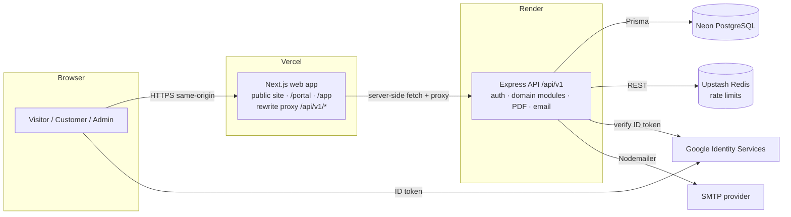
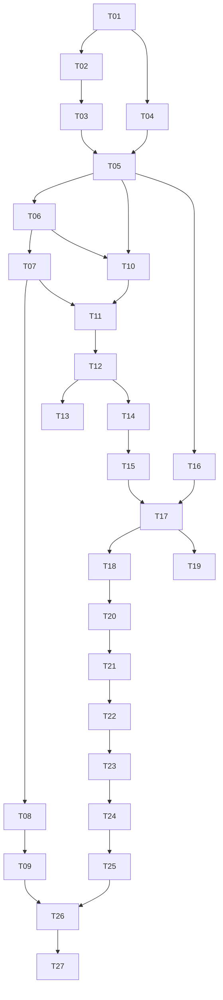

# FixFlow — Implementation Plan

**Created:** 2026-10-28 · **Basis:** `FixFlow_Project_Documentation.docx` v1.0 (canonical), its Markdown mirror, `Note.md`, and `DECISIONS_AND_OPEN_QUESTIONS.md`.

This plan breaks the FixFlow MVP into 27 sequential, independently verifiable tasks. Each task has a prompt in `prompts/` (index: `prompts/README.md`), and progress is tracked in `docs/IMPLEMENTATION_PROGRESS.md`. Requirements are mapped to tasks in `docs/REQUIREMENTS_TRACEABILITY.md`.

---

## 1. Starting point

- **Repository state (2026-10-28):** a git repository with no commits that contains only `docs/` (the spec in DOCX and Markdown, and `Note.md`). There is no application code, configuration, dependencies, tests or existing instructions to preserve.
- **Local toolchain:** Node 20.19.4 (end-of-life, so it must be upgraded to 24 LTS, see D-05), npm 10.9, Docker 29 (used for the local test database), git 2.45. pnpm and the GitHub CLI are not installed.
- **External services:** Neon, Upstash, a Google OAuth client, an SMTP provider, Render and Vercel. The owner provides credentials during development (Q-04). Every task can make local progress without them.

## 2. Architecture summary

- **One business, many services** (D-01). There are two authenticated roles: `BUSINESS_ADMIN` (from an allowlist) and `CUSTOMER` (from Google sign-in). Technicians are resource records.
- **Modular monolith API** (spec §13.3): `auth`, `activity`, `notifications`, `email`, `settings`, `services`, `customers`, `service-requests`, `quotations`, `technicians`, `work-orders`, `invoices` (including payments and PDF), `dashboard`. Pure domain rules live in `*.domain.ts`; services own transactions; serializers are split into customer and admin variants.
- **Web app** (spec §13.4): route groups for marketing, auth, `/app` (admin) and `/portal` (customer); `features/*` hold feature UI; `components/ui|forms|layout` hold the design system; `lib/api|auth|formatting` hold the API client, auth helpers and formatting.
- **Integrity mechanisms:**
  - server-side transition maps (D-21, D-22, D-24, D-26)
  - `expectedStatus` checks (D-46)
  - conditional updates and row locks for acceptance, scheduling and payments
  - partial unique indexes (one SENT quotation per request, one work order per quotation, one non-VOID invoice per work order)
  - atomic reference counters (D-17)
  - shared `decimal.js` money calculation (D-18, D-19, D-44)
  - time-based status sync without cron (D-23)

## 3. Phases

| Phase | Goal | Tasks | Exit gate |
|---|---|---|---|
| 1. Foundation | A runnable monorepo with API platform, database and design system | T01–T04 | A fresh clone installs, starts web and API, migrates and seeds the DB; CI passes; the styleguide renders the design system at all widths |
| 2. Identity, configuration and public experience | Secure sign-in, configurable business and catalogue, polished public site, early hosted preview | T05–T09 | Customers browse active services; an admin manages the catalogue and settings; unauthorized access is rejected; the hosted preview proves the cookie and proxy architecture |
| 3. Customers and service requests | Customers request work; admins review it | T10–T13 | A request is submitted and reviewed with correct ownership restrictions; the customer sees customer-visible history only |
| 4. Quotations | Priced offers and customer decisions | T14–T15 | An accepted quote is proven through the UI and API and cannot be accepted twice or after expiry or voiding |
| 5. Technicians, scheduling and job execution | Convert, schedule, execute and complete jobs | T16–T19 | Accepted quote → scheduled work order → completed job, with overlap blocking and a usable calendar |
| 6. Invoicing and payments | Bill completed work and track payments | T20–T22 | Completed job → issued invoice (PDF) → payment recorded; the customer sees their invoice only |
| 7. Operational insight | An action-oriented dashboard and portal overview | T23 | KPIs derived from the DB in the business timezone; needs-attention queue links to real records |
| 8. Demo readiness and release | Showcase data, hardening, production demo, portfolio package | T24–T27 | The deployed demo repeats the full journey without developer intervention; README, screenshots and case study are complete and honest |

Spec "Phase 0 — product definition and design" is covered by this planning phase (journeys, statuses, data model and scope in the decisions log) and by T04 (design system and screen blueprints).

## 4. Task breakdown

Each task's full scope, instructions, acceptance criteria and verification steps are in its prompt. The summary below gives the objective, main deliverables and the acceptance criteria that gate completion.

### Phase 1 — Foundation

**T01 — Repository, tooling and CI foundation** · deps: none · `prompts/01-repository-foundation.md`
- Deliverables: npm workspaces (`apps/web`, `apps/api`, `packages/shared`, `e2e`); strict TypeScript; ESLint and Prettier; Vitest per package; a Playwright smoke test; a Next.js app with the `/api/v1` rewrite proxy; an Express 5 app with `GET /api/v1/health`; `.env.example` files; `.nvmrc`; a GitHub Actions CI workflow; a README skeleton.
- Acceptance: clean `npm install`; `npm run dev` starts both apps; `curl :3000/api/v1/health` returns the API response through the proxy; `lint`, `typecheck`, `test`, `build` and `test:e2e` pass.

**T02 — API platform foundation** · deps: T01 · `prompts/02-api-platform.md`
- Deliverables: Zod-validated env config; pino with request IDs and redaction; helmet, CORS and trust-proxy setup; the `AppError` model and error codes in shared; validation middleware; pagination helpers; `Clock`; a `RateLimiter` (Upstash and in-memory); app factory and test harness; `docs/API.md` and `docs/ARCHITECTURE.md` skeletons.
- Acceptance: the error contract is tested (400/404/422/429/500, no stack leak); redaction is tested; rate limiting returns 429 with `Retry-After`; startup fails fast on missing env without printing values.

**T03 — Database schema, migrations and base seed** · deps: T02 · `prompts/03-database-schema.md`
- Deliverables: Prisma for Neon (pooled and direct URLs); the full MVP schema with enums, FKs, uniques, partial unique indexes and CHECK constraints; `ReferenceCounter` with `nextReference()`; `recordActivity()`; a Docker Compose test DB; a guarded test-DB reset; `/health/ready`; an idempotent base seed (settings, 5 services, demo accounts with env-supplied passwords); CI Postgres service; ER diagram.
- Acceptance: `migrate deploy` works on an empty DB; constraint tests pass; concurrent reference generation produces unique sequential values; the Prisma and shared enum parity test passes; the seed is idempotent.

**T04 — Design system, UI primitives and application shells** · deps: T01 (can run alongside T02–T03) · `prompts/04-design-system.md`
- Deliverables: `docs/DESIGN_SYSTEM.md` (tokens, type, spacing, status mapping, principal-screen blueprints); Tailwind tokens; fonts; customized shadcn/ui primitives; form fields; `StatusBadge`; the DataTable-to-cards pattern; empty, loading and error states; dialogs and toasts; `lib/formatting`; public, auth, admin and portal shells; FixFlow logo; dev-only `/styleguide`.
- Acceptance: the styleguide renders all components and states at 360, 768, 1024 and 1440 px without overflow; axe shows no serious or critical violations; `StatusBadge` covers every status enum; formatting is tested with business timezone and currency.

### Phase 2 — Identity, configuration and public experience

**T05 — Authentication, sessions and access control** · deps: T03, T04 · `prompts/05-authentication.md`
- Deliverables: local `register`/`login` (Argon2id), `POST /auth/google` (ID-token verification and safe account linking), forgot/reset/change password, `/auth/logout`, `/auth/me`; DB sessions with rolling renewal; `requireAuth`, `requireAdmin` (allowlist) and `requireCustomer`; ownership helper (404); Origin-check CSRF middleware; auth rate limits; a minimal `EmailSender` (SMTP and log) for the reset email; `/login`, `/register`, `/forgot-password`, `/reset-password` with both sign-in methods and a demo-accounts panel; seeded demo-account passwords; safe `returnTo`; route protection; role-aware shells with sign-out; minimal honest `/app/dashboard` and `/portal` home pages.
- Acceptance: integration tests cover local register/login, generic login errors, Google new user and linking (including the pre-hijacking rule), allowlisted admin, local registration refused for admin emails, reset token single-use and expiry, inactive user, expired or tampered session, logout, wrong role 403, CSRF 403, rate limit 429; E2E covers form login with demo accounts, register, reset via the outbox link, role redirects and logout.

**T06 — Activity timeline, notifications and email infrastructure** · deps: T05 · `prompts/06-activity-notifications-email.md`
- Deliverables: timeline query service (admin and customer audiences); `notify()` / `notifyAdmins()` inside transactions; notification endpoints (list, mark read, mark all read); `NotificationBell` in both shells; the full escaped template set and branded layout on top of T05's `EmailSender`; post-commit dispatcher with `EmailDeliveryLog` and the reserved-domain recipient policy (D-52); the reset email moved onto the dispatcher.
- Acceptance: notification ownership 404; email failure leaves the business operation intact and logs `FAILED`; the log transport records `LOGGED`; an HTML-injection payload is escaped; the customer timeline excludes internal events.

**T07 — Business settings and service catalogue management** · deps: T06 · `prompts/07-settings-service-catalogue.md`
- Deliverables: public and admin settings endpoints; admin service CRUD with publish, unpublish, archive and restore; public service endpoints (active only, by slug); `/app/settings/business`; `/app/settings/services` list and editor.
- Acceptance: unpublished and archived services are excluded from public endpoints; validation covers timezone, currency, tax and HTTPS URLs; slug conflict returns 409; admin-only enforcement; activity events recorded.

**T08 — Public website and service pages** · deps: T07 · `prompts/08-public-website.md`
- Deliverables: homepage (hero, services, how it works, trust, service area, FAQ, contact); `/services` with category filter; `/services/[slug]`; `/privacy` (demo privacy notice); SEO metadata, sitemap and robots; demo banner; graceful handling when the API is unavailable.
- Acceptance: data comes from the API; an inactive slug returns 404; 4-width screenshots without overflow; axe clean; keyboard-operable mobile navigation; meaningful titles and descriptions.

**T09 — Hosted preview deployment (walking skeleton)** · deps: T08 · `prompts/09-preview-deployment.md`
- Deliverables: `render.yaml`, Vercel configuration, a Neon preview/prod branch, environment variables, `docs/DEPLOYMENT.md`, and verification of the proxy, cookies, Origin and client-IP headers, Google sign-in and cold-start UX.
- Acceptance: on HTTPS, a sign-in with a demo account (login form) and with Google sets a first-party cookie, and authenticated calls work in Chromium and WebKit/Safari. If credentials are missing, the task is `BLOCKED`; later tasks other than T26 do not depend on it.

### Phase 3 — Customers and service requests

**T10 — Customer profile and service addresses** · deps: T05, T06 · `prompts/10-customer-profile-addresses.md`
- Deliverables: `GET/PATCH /customers/me`; address CRUD and set-default; `/portal/profile`.
- Acceptance: strict payloads reject `role` and `email` changes (FR-014); exactly one default address; cross-customer address access returns 404; admin calls return 403.

**T11 — Service request submission and customer request tracking** · deps: T07, T10 · `prompts/11-service-request-submission.md`
- Deliverables: `POST /requests` (active-service check, address snapshot, preferred window, `FF-` reference, idempotency key, activity, admin notifications and emails); `GET /requests/me` and `/requests/:id`; the `/request-service` flow with auth return; confirmation; `/portal/requests` list and detail.
- Acceptance: an inactive service is rejected through a direct API call; invalid input creates no partial record; the reference format is correct and unique; customer B gets 404; no internal fields appear in customer DTOs; E2E covers visitor → sign-in → submit → confirmation.

**T12 — Admin request queue and request review** · deps: T11 · `prompts/12-admin-request-queue.md`
- Deliverables: `GET /admin/requests` (search, filters, sort, pagination, status counts); admin request detail with customer history and `availableActions`; status endpoint (start review, cancel, reopen); notes with visibility; `/app/requests` and `/app/requests/[id]`.
- Acceptance: the transition table is unit-tested; invalid transitions return 409 with the record unchanged; cancel requires a reason; stale `expectedStatus` returns 409; internal notes are never visible to the customer (API and E2E).

**T13 — Admin customer management** · deps: T12 · `prompts/13-admin-customer-management.md`
- Deliverables: `GET /admin/customers` (search, counts, outstanding balance), customer detail with history tabs, internal customer notes; `/app/customers` and `/app/customers/[id]`; link from request detail.
- Acceptance: admin-only; search by name, email and phone; history shows only that customer's records; internal customer notes never reach customer endpoints.

### Phase 4 — Quotations

**T14 — Quotation builder, sending and replacement (admin)** · deps: T12 · `prompts/14-quotation-builder.md`
- Deliverables: `calculateDocumentTotals()` in shared with exhaustive tests; draft create and update; send, void and replace; expiry sync; request status sync; customer quotation DTO endpoint (for preview); cancel-request integration; `/app/quotations/[id]` editor with live preview, field errors, preview, send and void dialogs.
- Acceptance: server totals match the D-19 worked examples; client totals are ignored; an edit after sending returns 409; at most one SENT per request; replacement atomically voids the previous quotation; expiry (via clock) sets EXPIRED and reverts the request; a double send creates no duplicate notification.

**T15 — Customer quotation review and decision** · deps: T14 · `prompts/15-customer-quotation-decision.md`
- Deliverables: `GET /quotations/me`; accept and decline with conditional updates in a transaction; `/portal/quotations/[id]` document view with confirm dialogs; portal request and overview links; admin views reflect the decision.
- Acceptance: a different customer gets 404 and the record is unchanged; double accept, expired accept and void accept return 409; concurrent accept and decline lets exactly one succeed; drafts are invisible; E2E covers both accept and decline.

### Phase 5 — Technicians, scheduling and job execution

**T16 — Technician resource management** · deps: T05 (run after T15 in sequence) · `prompts/16-technician-management.md`
- Deliverables: technician CRUD, activate and deactivate; upcoming assignments; `/app/technicians`.
- Acceptance: admin-only; inactive technicians are excluded from the assignable list; deactivation warns about upcoming jobs.

**T17 — Work-order conversion, scheduling and assignment** · deps: T15, T16 · `prompts/17-work-order-scheduling.md`
- Deliverables: idempotent conversion; schedule and reschedule with technician row lock and overlap blocking; conflict pre-check endpoint; admin work-order list and detail; `/app/jobs` and `/app/jobs/[id]` with a scheduling dialog; customer notifications.
- Acceptance: double or concurrent conversion creates one work order; overlap returns 409 (including concurrent attempts); back-to-back slots are allowed; an inactive technician is rejected; the reschedule records old and new times.

**T18 — Job lifecycle, completion and customer job tracking** · deps: T17 · `prompts/18-job-lifecycle-completion.md`
- Deliverables: the transitions endpoint (start, complete, needs rescheduling, cancel); completion notes (customer-visible and internal); a ready-to-invoice filter; `GET /work-orders/me` and `/work-orders/:id`; `/portal/jobs` list and detail; portal overview "Upcoming jobs".
- Acceptance: invalid transitions return 409 with the record unchanged; completion without a note returns 422; the customer DTO excludes internal notes; cross-customer access returns 404.

**T19 — Scheduling calendar** · deps: T17 (can run alongside T18) · `prompts/19-scheduling-calendar.md`
- Deliverables: a calendar range endpoint; `/app/calendar` week and day views; agenda (list) view; technician filter; job drawer with reschedule; needs-scheduling panel; business-timezone positioning.
- Acceptance: the layout algorithm and timezone positioning are unit-tested (including a DST week and a browser timezone different from the business timezone); the agenda view works at 360 px; blocks have accessible labels; E2E reschedules from the calendar.

### Phase 6 — Invoicing and payments

**T20 — Invoice drafting, issuance and voiding** · deps: T18 · `prompts/20-invoice-drafting-issuance.md`
- Deliverables: status derivation and overdue sync; create a draft from a completed job; draft editing (shared line-item editor); issue with `INV-` number and snapshots; void; `GET /admin/invoices` with filters; `/app/invoices` and `/app/invoices/[id]` with a print layout.
- Acceptance: draft from a non-completed job returns 409; a second non-VOID invoice returns 409; edit after issue returns 409; concurrent issue assigns one number; void with active payments returns 409; overdue boundary uses the business timezone.

**T21 — Manual payment recording and corrections** · deps: T20 · `prompts/21-payment-recording.md`
- Deliverables: record payment (invoice row lock) and void payment with reason; balance and status recalculation; payments panel and dialogs; customer notification.
- Acceptance: zero or negative amounts return 422; an amount above the balance returns 422 with a helpful message; the exact balance gives PAID; partial payment gives PARTIALLY_PAID, or OVERDUE when past due; concurrent overpayment is prevented; voiding a payment recalculates; no delete path exists.

**T22 — Invoice PDF and customer invoice portal** · deps: T21 · `prompts/22-invoice-pdf-customer-portal.md`
- Deliverables: PDF builder from snapshots; authorized `GET /invoices/:id/pdf`; `GET /invoices/me` and `/invoices/:id`; `/portal/invoices` list and detail with download; admin download.
- Acceptance: customer B gets 404 on both the invoice and the PDF; customers get 404 on drafts; correct headers (`application/pdf`, `no-store`); E2E download; manual A4 and Letter print check documented.

### Phase 7 — Operational insight

**T23 — Admin dashboard, portal overview and list exports** · deps: T22 · `prompts/23-dashboard-overview-exports.md`
- Deliverables: `GET /admin/dashboard/summary` (5 KPIs, needs attention, upcoming schedule, recent activity, ranges, metric definitions); `GET /customers/me/overview`; final `/app/dashboard` and `/portal`; CSV export for requests, jobs and invoices (SHOULD).
- Acceptance: KPI numbers match a deterministic fixture; period boundaries use the business timezone; every KPI and attention item links to a real filtered list or record; CSV avoids unnecessary personal data and escapes formula injection.

### Phase 8 — Demo readiness and release

**T24 — Showcase demo data and demo-mode safeguards** · deps: T23 · `prompts/24-demo-data-safeguards.md`
- Deliverables: a realistic showcase seed built through domain services with dates relative to "now" (spec §19.3 volumes); invariant checker; guarded `db:reset-demo`; demo banner and privacy notice finalized; demo write rate limits; optional scheduled reset workflow.
- Acceptance: the seed is internally consistent (checker passes); every status appears; the dashboard shows meaningful numbers; resetting twice gives identical structure; reset refuses to run against the wrong database.

**T25 — End-to-end journey, accessibility and quality hardening** · deps: T24 · `prompts/25-quality-hardening.md`
- Deliverables: Playwright main-journey spec (spec §18.3 steps 1–10) on Chromium, Firefox and WebKit; negative journeys; authorization matrix test over all routes; customer-DTO leak tests; responsive and overflow checks; axe sweep; CSP and security headers on web; error and not-found pages; visual QA checklist (§18.4) with fixes; E2E in CI.
- Acceptance: the main journey passes on all three engines; the matrix shows 401/403 everywhere expected; no serious or critical axe violations on key screens; no horizontal overflow at the four widths; the checklist is documented with results.

**T26 — Production demo release** · deps: T09, T25 · `prompts/26-production-release.md`
- Deliverables: production Neon branch migrated and seeded; production Render and Vercel deployments with all env vars; Google OAuth production origins; SMTP with a verified sender; Upstash; HTTPS, cookies and CSP verified; production smoke test; backup and reset runbook.
- Acceptance: the full primary journey is repeated on the deployed demo without developer intervention; secrets are not committed; health checks are green; the email delivery status is truthful.

**T27 — Documentation and portfolio package** · deps: T26 · `prompts/27-documentation-portfolio.md`
- Deliverables: final README (spec §21.4); `docs/ARCHITECTURE.md` with diagram; `docs/API.md` reference; real screenshots (spec §22.2 order) via a Playwright capture script; `docs/DEMO_SCRIPT.md`; `docs/PORTFOLIO_CASE_STUDY.md`; known limitations; final traceability audit.
- Acceptance: a fresh clone can be set up from the README alone; every MUST requirement is either verified or listed with its limitation; the case study is honest (no invented clients or outcomes).

## 5. Dependency graph and execution order

**Recommended order:** T01 → T02 → T03 → T04 → T05 → … → T27, in numeric order. Run one task per session.

**Safe deviations:**
- T04 may run before or between T02 and T03.
- T16 may run at any point after T05.
- T19 may run before T18.
- If T09 is `BLOCKED` on credentials, continue with T10 and return to T09 before T26.

Never start a task until all its prerequisites are `COMPLETED`.

## 6. Cross-cutting technical decisions

See `DECISIONS_AND_OPEN_QUESTIONS.md` for the rationale. The most consequential decisions:

| Area | Decision |
|---|---|
| Hosting topology | Vercel web proxies `/api/v1` to the Render API, so session cookies are first-party (D-06) |
| Identity | Local email/password (Argon2id) and Google Sign-In; admin allowlist; seeded demo accounts with documented credentials (D-07, D-08, D-09, D-51). D-08 is still **PROPOSED** |
| Sessions and CSRF | Opaque DB-backed sessions in an HTTP-only cookie; SameSite=Lax plus Origin check (D-10, D-11) |
| Redis | Upstash for rate limiting only (D-12) — **PROPOSED** |
| Money | `decimal.js`, `Decimal(12,2)`, half-up 2 dp, shared calculation, server authoritative (D-18, D-19, D-44) |
| Statuses | Explicit transition maps; `expectedStatus`; time-based sync without cron (D-21–D-26, D-46) |
| Scheduling | Block overlaps per technician using half-open intervals and a row lock (D-25) — **PROPOSED** |
| Activity | Unified `ActivityEvent` with internal and public summaries (D-29) |
| PDF | Lightweight Node library, no headless browser (D-28) |
| Testing | Vitest, Supertest on real Postgres, Playwright through the real login form with demo accounts, axe (D-37) |

## 7. Testing and verification strategy

| Layer | What | Where it is introduced |
|---|---|---|
| Unit | Money totals, transitions (table-driven), overlap, status derivation, references, permission predicates, timezone boundaries, formatting, input limits | With each domain module (T03, T05, T11–T23) |
| API integration | Every endpoint: success, 401, 403, cross-customer 404, 409 invalid or stale transitions with the record unchanged, 422 validation, duplicate-safety and concurrency, DTO leak checks | Each backend task; consolidated authorization matrix in T25 |
| Component | Form fields, `StatusBadge`, line-item editor, calendar layout | T04, T14, T19 |
| E2E (Playwright) | One spec per user-facing slice; full main journey and negative journeys in T25 | T01 (smoke) → T27 |
| Accessibility | axe on new key screens per task; keyboard walkthrough in T25 | T04 onward |
| Responsive | Screenshots and overflow assertions at 360, 768, 1024 and 1440 | T04 onward; sweep in T25 |
| Manual | Google sign-in, real SMTP delivery, PDF print on A4 and Letter, Safari cookie behaviour on the hosted preview | T05, T09, T22, T26 |

Required commands per task are listed in `CLAUDE.md` §11. CI (GitHub Actions) runs lint, typecheck, unit tests, integration tests and build from T03, and E2E from T25.

## 8. Credentials timeline

| Needed for | Credential | If unavailable |
|---|---|---|
| T03 | Neon `dev` connection strings (pooled and direct) | Develop against Docker Postgres; record Neon verification as pending |
| T05 | Google OAuth Web client ID (authorized JS origin `http://localhost:3000`) | Local sign-in works regardless; Google verified with a fake verifier; manual Google check pending |
| T06 / T09 | SMTP credentials and verified sender | `EMAIL_TRANSPORT=log` |
| T09 | Render and Vercel accounts, Neon preview or prod branch, Upstash REST URL and token | T09 `BLOCKED`; continue with T10+ |
| T26 | All production values | T26 `BLOCKED` |

## 9. Risks and mitigations (plan-specific)

| Risk | Mitigation |
|---|---|
| Cross-site cookies fail between Vercel and Render | Same-origin rewrite proxy (D-06), verified early in T09 rather than at release |
| Render cold starts make the demo look broken | Liveness-only health check; friendly retry and "waking" states; paid instance for the public demo (Q-09) |
| Neon compute hours drained by health checks | Liveness check without DB access (D-14) |
| Google sign-in cannot be automated in tests | E2E uses local sign-in with seeded demo accounts; Google paths are covered by API tests with an injectable fake verifier (D-09, D-37) |
| Public demo collects real personal data | Owner chose open sign-up: demo-mode notices on login and register, privacy page, regular resets, and a `PUBLIC_SIGNUP_ENABLED` switch (D-09) |
| UI drifts to generic screens | Design system and screen blueprints first (T04); visual acceptance criteria and screenshots in every UI task; QA sweep (T25) |
| Business-rule gaps let invalid states through | Transition maps decided up front (D-21–D-27); unit-tested domain modules; "record unchanged" integration assertions |
| Scope creep | Non-goals in `CLAUDE.md`; D-39; "no dead UI" rule; follow-ups list instead of ad-hoc additions |
| Node 20 end-of-life locally | T01 gate requires Node 24 LTS (D-05) |

## 10. Definition of done (every task)

1. All acceptance criteria in the prompt are met and observable.
2. Required tests exist and pass; lint, typecheck and build pass; E2E passes for UI tasks. The actual results are recorded in the progress file.
3. No secrets are committed and no sensitive data is logged; authorization is enforced on the server and tested.
4. UI work meets the design system, has every interaction state, and works at the four widths with accessibility checks.
5. Docs are updated: progress, traceability, `prompts/README.md` status, decisions, and README/ARCHITECTURE/API/.env.example as applicable.
6. The completion report is delivered, including known limitations and the next recommended task.
