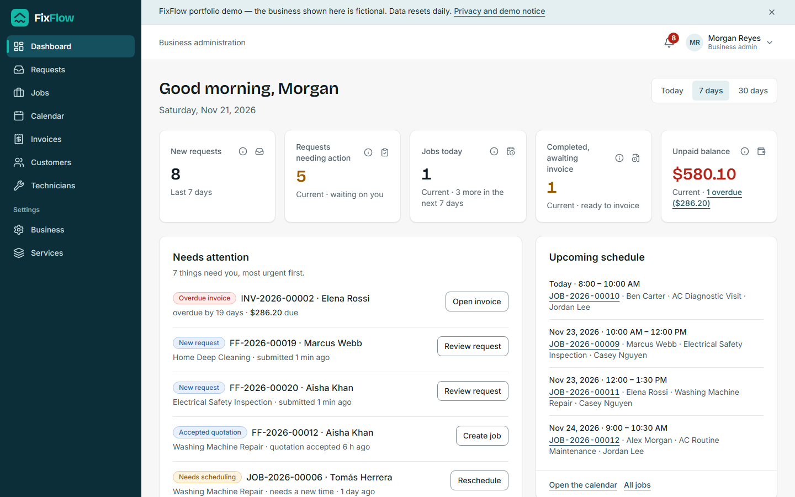
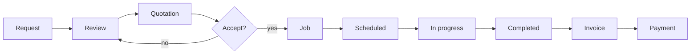
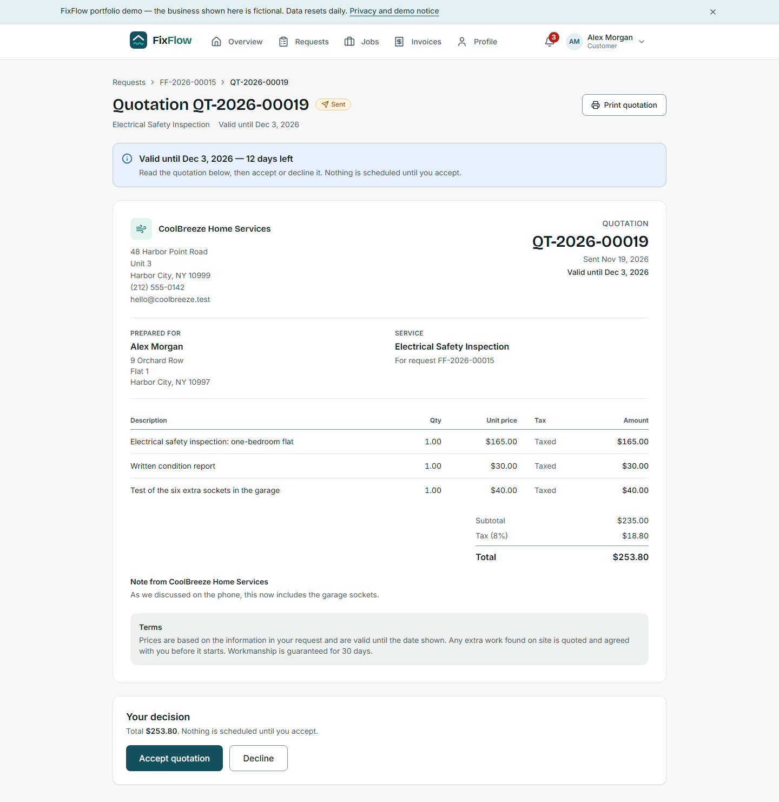
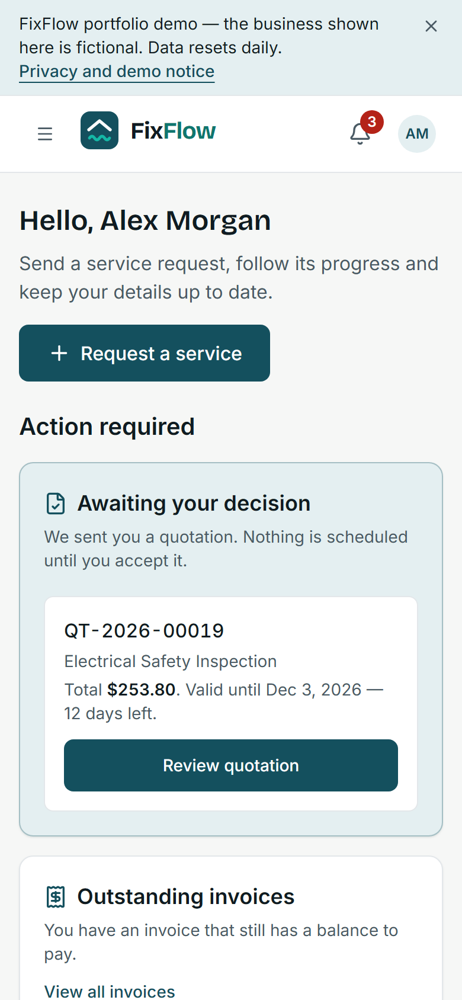

# 1. Title

## FixFlow — Home Service Business Management Platform

A web application that connects a small home-service business's public website, its internal dashboard and its customers' portal, from the first service request to the recorded payment. A self-initiated portfolio project.

> **Before this page is published:** the fields marked **[Owner to complete]** (section 4, and the repository and demo links in section 7) are for the project owner to fill in accurately. Nothing in them has been written on the owner's behalf.

# 2. Problem

A small repair or maintenance company often runs its work across separate tools. Requests arrive by phone and message. Quotations are typed into a document and emailed. The schedule lives in a calendar, invoices are made in another program, and payments are noted wherever there is room. Nothing connects them, so:

- the business cannot see at a glance what needs doing next;
- a quotation can be changed after the customer agreed to it, or the same job booked twice;
- the customer cannot see where their job stands without calling;
- a total, a date or a status is retyped several times, and sooner or later differs between documents.

# 3. Solution

FixFlow is one connected application with three experiences:

- **A public website** that presents the business and its services and takes service requests.
- **A customer portal** where a customer follows each request, reads and answers a quotation, sees their scheduled and completed jobs, and downloads invoices.
- **A business dashboard** where the team reviews requests, builds and sends quotations, creates and schedules jobs with technicians, completes them, issues invoices and records payments.

One journey runs through all three, and each step is a recorded state change that the next step relies on:

The demo business, _CoolBreeze Home Services_, and everything in it are fictional.

# 4. My contribution

> **[Owner to complete]** This section is deliberately left for the project owner to write. The case study must state accurately what was designed, built and done by whom, and how AI-assisted development was or was not used. Please replace each bracketed field with a plain statement of fact; delete any line that does not apply.

**Role.** **[Owner to complete: for example your role on this project and whether it was built alone.]**

**Work areas.** For each, say what you personally did.

| Area | What I did |
| --- | --- |
| Product definition and scope | **[Owner to complete]** |
| Design (visual system, screens) | **[Owner to complete]** |
| Frontend (Next.js, React, Tailwind) | **[Owner to complete]** |
| API (Express, validation, business rules) | **[Owner to complete]** |
| Database (PostgreSQL, Prisma, migrations) | **[Owner to complete]** |
| Testing (unit, integration, end to end, accessibility) | **[Owner to complete]** |
| Deployment (Vercel, Render, Neon) | **[Owner to complete]** |

**AI-assisted development.** **[Owner to complete: whether AI coding tools were used, for which parts, and how the output was reviewed, tested and decided on. Be specific and truthful; clients may ask.]**

**Time and effort.** **[Owner to complete, optional.]**

# 5. Highlighted capabilities

| Capability | What it does |
| --- | --- |
| **Request workflow** | A customer sends a request for an active service with an address and a preferred time; it gets a reference such as `FF-2026-00012`, and the business reviews it, adds internal or customer-visible notes and moves it through a defined set of statuses |
| **Quotation approvals** | Line items, a discount and tax with live totals; send, replace or void; the customer accepts or declines once, and an expired or withdrawn quotation can no longer be answered |
| **Scheduling** | Jobs created from accepted quotations, booked with technician resources; overlapping visits for one technician are refused; a week, day and agenda calendar; start, complete, send back for a new time, or cancel |
| **Customer records** | A directory with contact details, saved addresses, request, quotation, job and invoice history, and staff-only notes |
| **Invoice PDF** | Invoices are drafted from the accepted quotation, issued (a number is assigned and the document is locked), voided with a reason, printed, and downloaded as a PDF built from the issued snapshot |
| **Manual payment tracking** | The business records money it received outside FixFlow; the balance and status follow, a part payment is supported, an overpayment is refused, and a mistake is corrected by a void, never an edit |
| **Dashboard and exports** | Five live figures and a needs-attention queue from the database in the business's time zone; CSV exports with minimal personal data |

# 6. Engineering decisions

## Role-based access, enforced on the server

There are two roles, `BUSINESS_ADMIN` and `CUSTOMER`; technicians are records, not accounts. Every protected endpoint checks the role **and** the ownership, and a record that is not yours is a `404`, not a `403`, so ids cannot be probed. Customers' scoping always comes from the session, never from an id in the request. The admin role needs the stored role and a still-listed email on every request, so revoking access takes effect at once.

_Evidence:_ an authorization matrix test walks Express's router, so a route added without an access rule fails the build; it probes all 84 routes as a visitor, a customer and an admin and then bursts each abuse-prone route against its rate limit. A second test reads every customer-facing response on the demo data and searches it for dozens of internal values taken from the database.

## Money is calculated on the server, with exact arithmetic

One pure function, shared by the server and the editor's preview, computes line subtotals, a proportional discount, tax on the taxable share and the total, with `decimal.js` and half-up rounding to two places. Amounts are decimal strings from the database to the screen, and no floating-point column exists. A request that names a total is rejected; the server recomputes from the stored lines.

_Evidence:_ worked examples are unit tests (for instance 252.00 with 45.50 taxable at 8% gives tax 3.64 and total 255.64); the amount paid on an invoice is only ever written as the sum of its active payments.

## State transitions are data, and only one place writes a status

The request, quotation, job and invoice lifecycles are tables in their domain files. A status is written only by a transition function that checks the table, and every endpoint takes the status the screen last saw: if the record has moved on, the answer is `409` and nothing changes. An invoice's status is derived from its total, its payments and its due date, so it cannot disagree with its own numbers.

_Evidence:_ each table is tested over every pair of statuses; refused changes are asserted to leave the record unchanged.

## Transaction safety against double clicks and races

A business change commits together with its history entry and in-app notification; emails are queued inside the transaction and sent only after the commit, and a failed email is logged and never reverses the action. Duplicates and races are prevented by row locks, conditional updates and database constraints: one job per quotation, one live invoice per job, no overpayment, no overlapping bookings for a technician, one answer to a quotation. The database itself refuses the states the application must never reach (partial unique indexes and CHECK constraints), and each such rule has a test that tries to break it directly.

_Evidence:_ concurrency tests fire the same operation in parallel (five conversions at once, two payments for one balance, two overlapping bookings, an accept racing a decline) and assert that exactly one wins and the data is consistent; failure-injection tests make a notification or an email fail and assert full rollback or an unaffected action.

## Responsive and accessible design

One design system with tokens declared once; status is always text plus colour; every screen has loading, empty, error and permission states; tables collapse to cards on narrow screens. The layouts were checked at 360, 768, 1024 and 1440 px, with no horizontal overflow, with axe and with a keyboard-only journey.

_Evidence:_ an automated sweep of 37 screens at four widths (axe, heading outline, overflow), a keyboard-only end-to-end journey and a main journey on Chromium, Firefox and WebKit.

## Other decisions worth reading

- **Same-origin proxy and first-party cookies:** the browser only talks to the web origin, which proxies the API, so the session cookie works in Safari and Firefox. Sessions are opaque random tokens; only a hash is stored.
- **Time:** everything is stored in UTC and shown in the business's time zone from its settings, never the browser's; a quotation is valid through the last day in the business's zone.
- **Honest email:** an email that was only logged is recorded as logged, never as sent, and the interface never claims delivery that did not happen.
- **A real demo, safely:** the demo dataset is built by calling the application's own services with a fake clock, checked by an 18-rule invariant checker, and reset daily by a command that refuses to run against any other database.

The full reasoning is in [ARCHITECTURE.md](ARCHITECTURE.md); the API is in [API.md](API.md).

# 7. Evidence

| Evidence | Where |
| --- | --- |
| **Deployed demo** | **[Owner to complete: the production demo address, when it is published.]** A hosted preview with the base data (not the full demo data) has been used to check hosting. |
| **Screenshots** | The [six captures](../README.md#screenshots) in `docs/screenshots/`, taken from the running application by `npm run screenshots`; a seventh shows the calendar |
| **Walk-through video** | **[Owner to complete: the link, once recorded.]** The script is [DEMO_SCRIPT.md](DEMO_SCRIPT.md) |
| **Repository** | **[Owner to complete: the repository link, if it is public.]** |
| **Documentation** | [README](../README.md), [ARCHITECTURE.md](ARCHITECTURE.md), [API.md](API.md), [DEPLOYMENT.md](DEPLOYMENT.md), [DESIGN_SYSTEM.md](DESIGN_SYSTEM.md) |
| **Test suites** | Unit, API integration against a real PostgreSQL, and Playwright end to end; the counts and how to run them are in the README |

The public pages use credited stock photographs (listed in the repository). The screenshots are captures of the application, not mock-ups.

# 8. Honest status

- FixFlow is a **self-initiated portfolio project**, not a commissioned system. It has **no clients, no users and no business outcomes**; there are no testimonials, ratings or results, and none are implied.
- The business, its people, addresses, phone numbers, prices and every amount are **fictional**.
- It is a **demonstration of capability**, not production-hardened software that has served real customers. FixFlow is not accounting or tax software and processes no payments.
- What is out of scope on purpose: multiple businesses, billing for FixFlow itself, a payment gateway or card data, technician logins, route optimisation, native apps, SMS or WhatsApp, and AI features.
- Known limitations are listed in the [README](../README.md#known-limitations). The production demo release is not complete; real SMTP delivery has not been checked yet.

### Future enhancements (not implemented)

These are ideas, not features: technician logins and a mobile job view; AI-assisted request summaries for staff review (never a binding quote); branded email templates with retries; scheduled reminders; working hours and service areas; file attachments with private access controls; reporting; multi-tenancy (which needs real architecture and security work); online payments through a reputable provider without handling card data; localisation.
